# Informe de seguridad y calidad en el desarrollo de software

## Optimizando el aseguramiento de la calidad y seguridad del software — Plataforma Atlas

**Asignatura:** ISY1102 — Seguridad y Calidad en el Desarrollo de Software
**Sección:** 002V
**Carrera:** Ingeniería en Desarrollo de Software
**Docente:** Christian Rodrigo Alvarez Lobos
**Fecha:** 25 de noviembre de 2026

**Integrantes (Grupo 2):**
- Luis Tasso
- Miguel Arredondo
- Nicolas Iturrieta

---

## ÍNDICE

1. Introducción
   1.1. Contexto del sistema evaluado y propósito del informe
   1.2. Consolidación y ajustes según retroalimentación de iteraciones anteriores
   1.3. Estructura del informe y alcance del aseguramiento continuo
2. Criterios de calidad
   2.1. Calidad del producto (ISO/IEC 25010)
   2.2. Seguridad (ISO/IEC 27001 y OWASP Top 10)
   2.3. Cumplimiento normativo y legal (Ley 19.628 y Ley 21.719)
3. Plan de pruebas y aseguramiento continuo
   3.1. Estrategia de pruebas: Pirámide de Testing, Shift-Left y Fail Fast
   3.2. Tipos de prueba, enfoques de seguridad y herramientas
   3.3. Criterios de aceptación y certificación
   3.4. Herramientas, recursos y entorno de prueba
   3.5. Diagrama de integración de controles de seguridad automatizados y trazabilidad normativa
   3.6. Cronograma de ejecución integral
4. Diseño de casos de prueba y automatización
   4.1. Criterios de selección de pruebas automatizadas y patrón Page Object Model (POM)
   4.2. Fichas de casos de prueba (funcionales, seguridad/pentesting, DAST, automatización E2E y estrés)
   4.3. Matriz de trazabilidad de requisitos (ERS y cobertura real)
5. Ejecución de pruebas y resultados
   5.1. Resumen consolidado de ejecución
   5.2. Detalle de ejecución de casos del ciclo de seguridad, automatización y estrés
   5.3. Impacto de la automatización en tiempo, recursos y resultados de estrés
   5.4. Criticidad de incidentes y escala de impacto
6. Propuesta de mejora y Plan de Mantenimiento
   6.1. Propuestas de mitigación priorizadas a defectos identificados
   6.2. Análisis del Plan de Mantenimiento del software (ISO/IEC 14764) para preservar calidad, seguridad y cumplimiento normativo
   6.3. Dictamen técnico final y consideraciones éticas/normativas
7. Anexos y evidencias técnicas reproducibles

---

## 1. Introducción

### 1.1. Contexto del sistema evaluado y propósito del informe

**Contexto del software a evaluar.** **Atlas** es una plataforma web de gestión de clientes y contratos orientada a pequeñas y medianas empresas (pymes) en Chile (Caso A). Su arquitectura comprende tres capas desplegadas mediante Docker Compose: un frontend en React 19 + Vite + Material UI (`atlas-frontend`, puerto `3350`), una API REST en Node.js 18 + Express 4.19 (`atlas-backend`, puerto `4450`) con documentación Swagger (`/docs/`), y una base de datos relacional PostgreSQL 17 (`atlas-postgres`, puerto `15432`). El sistema administra autenticación, gestión de clientes, contratos con documentos adjuntos, usuarios/roles (`administrador` y `editor`), métricas operativas y registros de auditoría.

**Propósito del informe.** Este documento consolida el proceso integral de aseguramiento de la calidad y seguridad de Atlas, integrando la planificación estratégica y el análisis estático de las fases iniciales con la **ejecución de pruebas dinámicas de seguridad (Pentesting y DAST con OWASP ZAP)**, el **diseño de un pipeline CI/CD DevSecOps con controles Shift-Left**, la **automatización de pruebas funcionales E2E (Selenium IDE y WebDriver con patrón POM)**, las **pruebas de carga, estrés y pico (Apache JMeter / concurrencia)** y un **Plan de Mantenimiento formal** orientado a preservar la calidad, la seguridad y el cumplimiento normativo/legal en futuras iteraciones del producto.

### 1.2. Consolidación y ajustes según retroalimentación de iteraciones anteriores

Con el fin de asegurar continuidad metodológica y rigor técnico, este informe mantiene los pilares validados desde la planificación inicial e incorpora íntegramente las correcciones derivadas de la retroalimentación del ciclo anterior, extendiéndolas a todas las pruebas automatizadas y de seguridad:

- **Pilares metodológicos consolidados:** trabajo sobre el despliegue real de Atlas en Docker (con evidencia verificable y revisión directa del código fuente), asociación explícita de cada criterio y caso de prueba a códigos reales del ERS (`RF-*`, `NFR-*`, `RB-*`) respaldada por una matriz de trazabilidad dedicada, y sustento técnico en estándares internacionales (**ISO/IEC 25010**, **ISO/IEC 27001**, **ISO/IEC/IEEE 29119**, **OWASP Top 10**, **ISTQB**) junto con la normativa chilena de protección de datos (**Ley 19.628** y **Ley 21.719**).
- **Ajustes técnicos incorporados y extendidos al ciclo actual:**
  1. **Evidencia dinámica cruda y reproducible:** ningún resultado se respalda únicamente con tablas redactadas a mano. Las pruebas manuales sobre la API se sustentan en comandos `curl` y respuestas HTTP reales (Anexo F), y las pruebas automatizadas del ciclo actual se respaldan con los reportes generados en la ejecución real del `12-11-2026` (`reporte_dast_zap_atlas.html`, `reporte_estres_atlas.html`, `jmeter_resultados_atlas.csv` y logs de `pytest`).
  2. **Matriz de trazabilidad con identificadores reales del ERS y cobertura honesta:** se utilizan exclusivamente los 21 códigos identificables del ERS (descartando identificadores internos `RQ-*`) y se declara la cobertura real alcanzada sin inflarla al 100 %. Con la incorporación de las pruebas de estrés JMeter, el requisito `NFR-PERF-3` (200 usuarios concurrentes) pasa de *No cubierto* a **Cubierto** (7 de 21 requisitos con cobertura plena: 33,3 %).
  3. **Interpretación fiel de `RF-5.2`:** se ratifica que `RF-5.2` admite cinco formatos de documento (**PDF, DOC, PPT, JPG y PNG**). El defecto crítico (`BUG-003`) consiste en que el backend carece de filtro y acepta archivos peligrosos (`.exe` y `.html`), además de presentar inconsistencias con la interfaz frontend.
  4. **Múltiples casos no funcionales con mediciones repetidas:** se mantienen `CP-013` (5 mediciones de rendimiento) y `CP-014` (usabilidad/accesibilidad Lighthouse), y se incorporan 4 escenarios no funcionales de carga, estrés y pico (`EST-01` a `EST-04`) con 575 muestras reales y medición de RTO.
  5. **Contabilización rigurosa de fallos:** todos los casos incumplidos (`CP-010`, `CP-011`, `CP-013`, `PENT-01/02/04/05`, `EST-03` y alertas DAST) se marcan explícitamente como **Falló** y se contabilizan en el resumen de ejecución, sin aplicar "riesgos aceptados".
  6. **Cronograma integral y trazabilidad de ejecución:** el cronograma cubre las tres fases de trabajo y cada caso del detalle de ejecución registra **fecha exacta y ejecutor responsable**.

### 1.3. Estructura del informe y alcance del aseguramiento continuo

El documento se organiza en seis secciones principales —Introducción, Criterios de calidad, Plan de pruebas y aseguramiento continuo, Diseño de casos de prueba y automatización, Ejecución de pruebas y resultados, y Propuesta de mejora y Plan de Mantenimiento— complementadas con los Anexos de evidencia técnica. Asimismo, la suite automatizada implementada (`auditor_transversal_atlas.py`, `test_atlas_pom.py`, `test_atlas_pentest_dast.py`, `test_atlas_stress.py`) queda preparada para reajustar y re-ejecutar el plan de pruebas de manera eficiente frente a futuras modificaciones del software.

---

## 2. Criterios de calidad

### 2.1. Calidad del producto (ISO/IEC 25010)

Conforme al modelo **ISO/IEC 25010 (SQuaRE)** y al ERS del sistema Atlas, el producto debe satisfacer:

- **Adecuación funcional:** cumplimiento completo de autenticación (`RF-1`), gestión de clientes (`RF-4`), contratos y documentos en formatos PDF, DOC, PPT, JPG y PNG (`RF-5`, `RF-5.2`), auditoría (`RF-6`) y reglas de negocio (`RB-2` aislamiento por empresa, `RB-3` un contrato por cliente, `RB-4` editor solo lectura, `RB-5` administrador con control total).
- **Eficiencia de desempeño:** operaciones CRUD bajo **300 ms** en carga normal (`NFR-PERF-1`), carga de página principal < **2 s** (`NFR-PERF-2`) y soporte de **200 usuarios concurrentes** (`NFR-PERF-3`) con tasa de error < 5 % en estrés y **RTO < 30 s**.
- **Usabilidad y accesibilidad:** interfaz responsiva con tipografía ≥ 12 px, contraste WCAG AA ≥ 4,5:1, etiquetas semánticas, idioma declarado (`lang="es"`) y puntuación Lighthouse de accesibilidad ≥ 0,90 (`NFR-USAB`).
- **Fiabilidad y estabilidad:** disponibilidad objetivo 99,5 % mensual (`NFR-DIS-1`), operaciones transaccionales (`BEGIN ... COMMIT`) que aseguren **RPO = 0** transacciones corruptas bajo concurrencia y manejo controlado de errores.
- **Mantenibilidad:** código modular, baja deuda técnica (< 5 % en SonarQube), complejidad cognitiva controlada y suite de pruebas automatizadas bajo patrón **Page Object Model (POM)**.

### 2.2. Seguridad (ISO/IEC 27001 y OWASP Top 10)

Alineado con **ISO/IEC 27001** (controles `A.9.4`, `A.10`, `A.12.4`, `A.14.2`, `A.18.1`) y **OWASP Top 10 (2021)**:

- **Control de acceso (`OWASP A01`, `NFR-SEG-4`):** autenticación JWT obligatoria en el 100 % de los endpoints que exponen o modifican datos y validación estricta de rol y empresa en el backend.
- **Protección criptográfica y secretos (`OWASP A02`, `NFR-SEG-2`):** contraseñas con hash robusto (`bcrypt`/`argon2`), eliminación de credenciales por defecto y prohibición de secretos en código fuente (`Gitleaks` y `SonarQube`).
- **Prevención de inyecciones y XSS (`OWASP A03`, `NFR-SEG-2`):** consultas SQL parametrizadas (`$1..$n`), saneamiento de entradas y política `Content-Security-Policy (CSP)`.
- **Configuración segura (`OWASP A05`):** CORS restringido a orígenes autorizados, cabeceras de endurecimiento vía `helmet` (`X-Frame-Options`, `X-Content-Type-Options: nosniff`, `CSP`) y Swagger `/docs/` deshabilitado o protegido en producción.
- **Autenticación e integridad de archivos (`OWASP A07` / `A08`, `NFR-SEG-9`):** protección contra fuerza bruta (`express-rate-limit`), sesiones en cookies `httpOnly; Secure; SameSite=Strict` y validación de extensión, tipo MIME y *magic bytes* en la carga de documentos.

### 2.3. Cumplimiento normativo y legal (Ley 19.628 y Ley 21.719)

Atlas trata datos personales, laborales y bancarios de clientes y usuarios en Chile. En consecuencia, está sujeto a la **Ley N.º 19.628** sobre Protección de la Vida Privada y su reforma integral mediante la **Ley N.º 21.719**, que exige licitud y consentimiento, minimización de datos, confidencialidad, seguridad por diseño, trazabilidad de accesos (auditoría protegida), respeto a derechos ARCO y notificación ante brechas de seguridad. La exposición de endpoints sin token (`BUG-001`) y las contraseñas en texto claro (`BUG-002`) constituyen incumplimientos directos de estas obligaciones legales.

---

## 3. Plan de pruebas y aseguramiento continuo

### 3.1. Estrategia de pruebas: Pirámide de Testing, Shift-Left y Fail Fast

La estrategia evoluciona desde el enfoque mixto inicial hacia un modelo de **aseguramiento continuo DevSecOps** sustentado en tres principios técnicos (ISO/IEC/IEEE 29119 e ISTQB):

1. **Pirámide de Testing:**
   - **Base (Unitarias y Validación Temprana):** validaciones rápidas de funciones puras, reglas de negocio y análisis estático (ESLint 9, SonarQube, Gitleaks, `npm audit`).
   - **Capa Intermedia (Integración y Seguridad API):** verificación automatizada entre API Express (`:4450`) y PostgreSQL (`:15432`) mediante `test_atlas.sh` y `test_atlas_pentest_dast.py`.
   - **Vértice (End-to-End y Resiliencia):** validación de flujos críticos de negocio desde el navegador con **Selenium IDE / Selenium WebDriver + POM** (`test_atlas_pom.py`) y pruebas de carga/estrés/pico con **Apache JMeter** (`Atlas_Stress_Test_JMeter.jmx` / `test_atlas_stress.py`).
2. **Shift-Left Security:** desplazar la detección de vulnerabilidades hacia las etapas más tempranas del ciclo (commit, build y pull request) para reducir el costo de remediación y prevenir el ingreso de secretos o dependencias vulnerables.
3. **Filosofía Fail Fast:** cada etapa del pipeline CI/CD actúa como un *gate* de bloqueo inmediato; si falla un control de secretos, SCA, SAST, E2E o DAST, el despliegue se detiene automáticamente sin consumir recursos en etapas posteriores.

**Priorización de pruebas:** basada en riesgo e impacto de negocio/legal —prioridad crítica a autenticación (`RF-1`), control de acceso (`NFR-SEG-4`, `RB-2`), carga de documentos (`RF-5.2`), rendimiento/concurrencia (`NFR-PERF-1/3`) y trazabilidad (`RF-6`).

**Criterios de entrada:** contenedores Docker levantados (`atlas-frontend`, `atlas-backend`, `atlas-postgres`), dataset semilla cargado sin datos personales reales, herramientas configuradas y casos revisados.

**Criterios de salida:** 100 % de los casos planificados ejecutados con evidencia cruda reproducible, incidentes clasificados por severidad, matriz de trazabilidad actualizada y dictamen formal emitido.

### 3.2. Tipos de prueba, enfoques de seguridad y herramientas

Con el propósito de cubrir integralmente la superficie de ataque y calidad del sistema Atlas, se aplicó una estrategia combinada de **Caja Blanca (White Box)** y **Caja Gris (Grey Box)** dentro de un marco ético y legal estricto (autorización exclusiva sobre el entorno Docker local `localhost`, uso de datos sintéticos y enmascaramiento de tokens JWT):

| Enfoque / Tipo de Prueba | Función en la Detección de Vulnerabilidades o Defectos | Herramientas Aplicadas en Atlas | Ejemplo Pertinente Detectado en Atlas |
|---|---|---|---|
| **Validación de Secretos (Shift-Left)** | Detecta contraseñas, tokens y cadenas de conexión expuestas en commits o historial Git antes del merge. | **Gitleaks v2** | Detecta credenciales PostgreSQL en `BACKEND/src/db.js:6` (`BUG-011`) y `JWT_SECRET="inseguro"` en `auth.js:7` (`BUG-004`). |
| **SCA (Análisis de Composición de Software)** | Identifica vulnerabilidades públicas (CVE) en librerías y dependencias de terceros. | **npm audit** (`--audit-level=high`) | Verifica dependencias de `BACKEND/package.json` y `FRONTEND/package.json` durante la etapa de Build. |
| **SAST (Análisis Estático — Caja Blanca)** | Inspecciona el código fuente sin ejecutarlo para hallar vulnerabilidades, *security hotspots*, *bugs* y deuda técnica. | **SonarQube 10.6**, **ESLint 9**, **auditor_transversal_atlas.py** | Detecta 1 vulnerabilidad **BLOCKER** (`secrets:S6698` en `db.js:6`), 4 *Security Hotspots* (`multer` sin límite, CORS `*`, `X-Powered-By`) y Security Rating **E** en backend. |
| **Pentesting (Caja Gris — 6 Fases)** | Simula ataques controlados (Reconocimiento, Escaneo, Enumeración, Explotación, Post-explotación y Documentación) para comprobar si las defensas reales resisten. | **Pytest Pentest** (`test_atlas_pentest_dast.py`), **curl**, **Burp Suite**, **sqlmap** | Confirma IDOR sin token (`GET /contratos/1`, `/usuarios/1`, `/auditoria` → `HTTP 200`, `BUG-001`), subida de `.exe` y `.html` XSS (`HTTP 201`, `BUG-003`), ausencia de rate-limit ante fuerza bruta (`BUG-006`) y resistencia a SQLi por consultas parametrizadas (`$1`). |
| **DAST (Análisis Dinámico — Caja Gris/Negra)** | Escanea la aplicación en ejecución (*Spider* + *Active Scan*) para detectar malas configuraciones HTTP, cabeceras ausentes y vectores de ataque en tiempo de ejecución. | **OWASP ZAP** (`zaproxy/action-full-scan`) | Identifica 5 alertas activas: `Access-Control-Allow-Origin: *` (Alta), ausencia de `X-Frame-Options` (Media), falta de `X-Content-Type-Options: nosniff` (Media), ausencia de `CSP` (Media) y exposición pública de Swagger `/docs/` (Baja). |
| **Automatización Funcional E2E** | Verifica repetitivamente flujos críticos de negocio desde la interfaz de usuario para detectar regresiones funcionales. | **Selenium IDE** (`Atlas_Selenium_IDE.side`) y **Selenium WebDriver + Pytest POM** (`test_atlas_pom.py`) | Valida login, creación de cliente (`76.543.210-K`), verificación en tabla y logout en ~13,1 s totales con aserciones explícitas y `WebDriverWait`. |
| **Pruebas de Carga, Estrés y Pico** | Evalúa rendimiento, punto de ruptura, resiliencia (RTO/RPO) y exposición a DoS o *race conditions* bajo alta concurrencia. | **Apache JMeter** (`Atlas_Stress_Test_JMeter.jmx`) y **Pytest Concurrencia** (`test_atlas_stress.py`) | Demuestra que `/contratos/1` soporta 200 usuarios (342,4 ms, 0 % error, RTO 8,4 ms), mientras `/clientes` colapsa a **4.019 ms** y 6,17 req/s por `delay(4000)` (`BUG-010`). |

### 3.3. Criterios de aceptación y certificación

- **Funcional y E2E:** cada flujo ejecutado cumple el resultado esperado, verifica aserciones explícitas (`assertText` / `verifyText`) y registra auditoría en operaciones críticas.
- **Seguridad:** 0 endpoints que expongan datos sin token válido; aceptación exclusiva de los 5 formatos de `RF-5.2` (PDF, DOC, PPT, JPG, PNG); resistencia a SQLi y XSS; 0 vulnerabilidades Críticas/Altas en SAST, DAST y Pentesting.
- **Rendimiento y resiliencia:** CRUD < 300 ms en carga normal (`NFR-PERF-1`); latencia < 2.000 ms y error < 5 % en estrés; soporte de 200 usuarios concurrentes (`NFR-PERF-3`); **RTO < 30 s** y **RPO = 0**.
- **Usabilidad:** Lighthouse de accesibilidad ≥ 0,90 y cumplimiento de contraste WCAG AA (4,5:1).
- **Criterio transversal de certificación:** **100 % de casos críticos de seguridad aprobados y 0 incidentes de severidad Crítica abiertos.**

### 3.4. Herramientas, recursos y entorno de prueba

- **Recursos humanos:** Luis Tasso (Seguridad, Pentesting, DAST y Pipeline CI/CD), Miguel Arredondo (Pruebas Funcionales, SAST y Automatización Selenium POM) y Nicolas Iturrieta (Pruebas No Funcionales, Usabilidad, Estrés JMeter y Entorno Docker).
- **Recursos técnicos:** Docker Compose, Node.js 20, Python 3.13 + Pytest, Selenium IDE/WebDriver, Apache JMeter, OWASP ZAP, SonarQube 10.6, ESLint 9, Gitleaks y navegador Chromium/Edge.
- **Entorno de prueba:** Laboratorio local aislado en Docker (`http://localhost:3350`, `http://localhost:4450`, `localhost:15432`) exclusivamente con registros sintéticos de prueba.

### 3.5. Diagrama de integración de controles de seguridad automatizados y trazabilidad normativa

El pipeline ejecutable `ci-devsecops-atlas.yml` integra **5 etapas secuenciales** con **4 controles Shift-Left Security** y bloqueos *Fail Fast*, trazados explícitamente a **ISO/IEC 27001**, **ISO/IEC 25010**, **OWASP Top 10** y **Ley 19.628 / 21.719**:

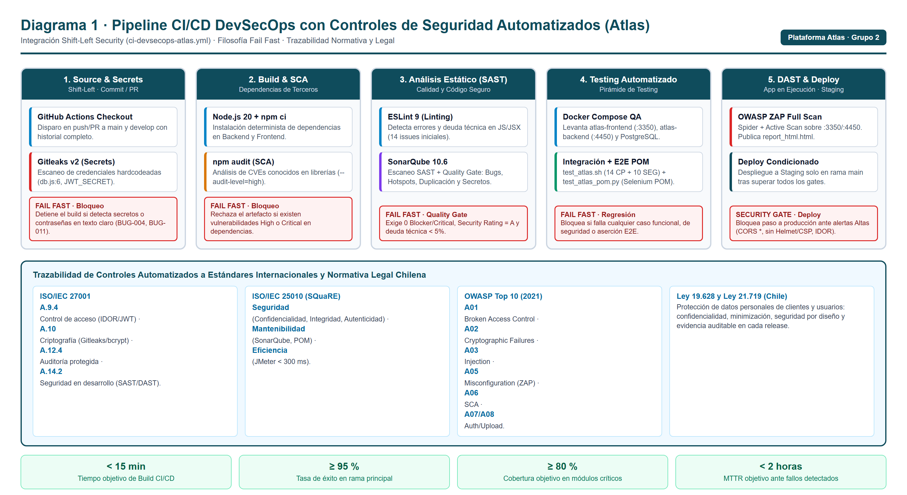

| Etapa CI/CD | Control Automatizado | Condición de Bloqueo (*Fail Fast*) | Estándar / Normativa Verificada |
|---|---|---|---|
| **1. Source & Secrets** | `Gitleaks v2` | Detiene el build si detecta contraseñas o secretos en el commit (`db.js:6`, `JWT_SECRET`). | ISO 27001 `A.10` · OWASP `A02` · Ley 19.628/21.719 |
| **2. Build & SCA** | `npm ci` + `npm audit --audit-level=high` | Bloquea si existen librerías con vulnerabilidades High o Critical. | ISO 27001 `A.14.2` · OWASP `A06` |
| **3. SAST** | `ESLint 9` + `SonarQube 10.6` | Bloquea si hay vulnerabilidades BLOCKER/CRITICAL, Security Rating < A o deuda > 5 %. | ISO 25010 Mantenibilidad/Seguridad · OWASP `A02/A05` |
| **4. Testing** | `test_atlas.sh` + `test_atlas_pom.py` | Bloquea si falla cualquier caso funcional, de seguridad API o flujo Selenium POM. | ISO/IEC/IEEE 29119 · ISO 25010 Adecuación · `RF-1..RF-6` |
| **5. DAST & Deploy** | `OWASP ZAP Full Scan` → Staging | Publica reporte HTML/JSON y bloquea despliegue ante alertas Altas (CORS, cabeceras, IDOR). | ISO 27001 `A.9.4/A.12.4` · OWASP `A01/A03/A05` · Ley 21.719 |

**Métricas de gobernanza del pipeline:** Tiempo de Build < **15 min** · Tasa de Éxito ≥ **95 %** · Cobertura de Código objetivo ≥ **80 %** en módulos críticos · MTTR < **2 horas**.

### 3.6. Cronograma de ejecución integral

| Fase | N.º | Actividad | Inicio | Fin | Responsable | Entregable |
|---|---|---|---|---|---|---|
| **Fase 1–2 (Plan y Verificación)** | 1 | Lectura ERS, criterios, diseño CP-001..CP-014 y matriz de trazabilidad | 19-10-2026 | 22-10-2026 | Luis Tasso / Miguel Arredondo | Secciones 1–4 y Matriz ERS |
| **Fase 1–2 (Plan y Verificación)** | 2 | Despliegue Docker, Smoke Test, pruebas API, rendimiento, usabilidad y SAST | 22-10-2026 | 29-10-2026 | Equipo completo | Anexos A–F y Evidencias SonarQube |
| **Fase 3 (Seguridad y Automatización)** | 3 | Ejecución de Pentesting (6 fases) y escaneo DAST / OWASP ZAP | 09-11-2026 | 12-11-2026 | Luis Tasso | `test_atlas_pentest_dast.py`, `reporte_dast_zap_atlas.html` |
| **Fase 3 (Seguridad y Automatización)** | 4 | Diseño de Pipeline CI/CD DevSecOps y diagrama normativo | 10-11-2026 | 12-11-2026 | Luis Tasso | `ci-devsecops-atlas.yml`, Diagrama 1 |
| **Fase 3 (Seguridad y Automatización)** | 5 | Automatización E2E (Selenium IDE) y refactorización a patrón POM | 11-11-2026 | 14-11-2026 | Miguel Arredondo | `Atlas_Selenium_IDE.side`, `test_atlas_pom.py` |
| **Fase 3 (Seguridad y Automatización)** | 6 | Pruebas de carga, estrés y pico (JMeter / concurrencia) y medición RTO | 12-11-2026 | 15-11-2026 | Nicolas Iturrieta | `Atlas_Stress_Test_JMeter.jmx`, `reporte_estres_atlas.html` |
| **Fase 3 (Seguridad y Automatización)** | 7 | Análisis del Plan de Mantenimiento y consolidación del informe técnico | 16-11-2026 | 25-11-2026 | Equipo completo | Informe consolidado y evidencias finales |

---

## 4. Diseño de casos de prueba y automatización

### 4.1. Criterios de selección de pruebas automatizadas y patrón Page Object Model (POM)

No todo caso de prueba conviene automatizarlo. Siguiendo criterios de eficiencia y aseguramiento de calidad (ISTQB), se automatizaron los **3 flujos críticos E2E** evaluando tres factores:

| Flujo Automatizado | 1. Frecuencia (Regresión) | 2. Riesgo de Negocio | 3. Estabilidad Técnica |
|---|---|---|---|
| **AUT-01 · Login Exitoso** | Se ejecuta en cada commit y como precondición de toda la suite. | Puerta de entrada; su falla inutiliza el 100 % de Atlas. | Selectores estables (`id="nombre_usuario"`, `id="password"`, `data-testid="button-login"`). |
| **AUT-02 · Crear Cliente** | Operación transaccional núcleo del CRM en cada iteración. | Sin clientes válidos no es posible emitir contratos. | Identificadores únicos (`id="rut-cliente-create"`, `id="crear-cliente-create"`). |
| **AUT-03 · Verificar Listado y Logout** | Verifica persistencia real Frontend–API–PostgreSQL y cierre de sesión. | Garantiza visibilidad por empresa (`RB-2`) y cierre seguro. | Navegación estable y `data-testid="button-layout-logout"`. |

**Refactorización a Page Object Model (`test_atlas_pom.py`):** los scripts grabados en Selenium IDE (`Atlas_Selenium_IDE.side`) presentan duplicación de selectores y fragilidad ante latencias. La refactorización a **POM** encapsuló selectores y acciones en las clases `LoginPage` y `ClientesPage`, logrando:
1. **Reducción > 40 % en líneas duplicadas** y mantenimiento centralizado de selectores.
2. **Esperas dinámicas explícitas (`WebDriverWait` + `expected_conditions`)**, absorbiendo la latencia artificial `delay(4000)` del backend sin generar falsos negativos.
3. **Aserciones obligatorias (`assertText` / `verifyText`)** y manejo estructurado con `logging` + `try/finally`, garantizando pruebas reproducibles en CI/CD.

### 4.2. Fichas de casos de prueba (consolidado representativo)

Se conservan los **14 casos base** (`CP-001` a `CP-014`, incluyendo `CP-010` con los 5 formatos de `RF-5.2`, `CP-011` IDOR, `CP-012` SQLi, `CP-013` rendimiento con 5 mediciones y `CP-014` usabilidad Lighthouse) y se incorporan **12 casos nuevos del ciclo actual**: 5 de Pentesting (`PENT-01` a `PENT-05`), 3 de Automatización E2E (`AUT-01` a `AUT-03`) y 4 escenarios de Carga/Estrés/Pico (`EST-01` a `EST-04`). A continuación se presentan las fichas representativas de este ciclo:

**PENT-01 · Enumeración e IDOR sin autenticación (Caja Gris)**

| Campo | Detalle |
|---|---|
| **ID / Nombre** | `PENT-01` · Acceso directo a contratos, usuarios y auditoría sin token |
| **Requerimiento** | `NFR-SEG-4`, `NFR-SEG-6`, `RB-2` (OWASP A01 / ISO 27001 A.9.4) |
| **Descripción** | Verificar mediante `test_atlas_pentest_dast.py` si los endpoints críticos rechazan peticiones sin cabecera `Authorization`. |
| **Precondiciones** | Contenedores Docker activos; registros semilla cargados (ID 1); sin token JWT. |
| **Pasos** | 1. Enviar `GET /contratos/1`, `GET /usuarios/1` y `GET /auditoria` sin token. 2. Registrar código HTTP y cuerpo retornado. |
| **Resultado esperado** | `HTTP 401 Unauthorized` en los tres endpoints sin fuga de datos personales ni logs. |
| **Criterio de aceptación** | 100 % de los endpoints consultados bloquean el acceso no autenticado. |
| **Datos de prueba** | Peticiones HTTP GET sin cabecera `Authorization` (`12-11-2026`, ejecutor: Luis Tasso). |
| **Resultado obtenido** | **FALLÓ** — `HTTP 200 / 200 / 200`: expone contratos, correo de usuario y logs internos (`BUG-001`, Crítico). |

**PENT-04 · Subida de ejecutable `.exe` y HTML activo XSS (`PENT-05`)**

| Campo | Detalle |
|---|---|
| **ID / Nombre** | `PENT-04` / `PENT-05` · Carga de archivos maliciosos (`.exe` y `.html` con `<script>`) |
| **Requerimiento** | `RF-5.2` (solo PDF, DOC, PPT, JPG y PNG), `NFR-SEG-4` (OWASP A03 / A08) |
| **Descripción** | Comprobar si `POST /contratos` valida extensión, tipo MIME y contenido real rechazando ejecutables y scripts XSS. |
| **Precondiciones** | Token JWT válido; cliente existente; archivos sintéticos `payload.exe` y `xss.html`. |
| **Pasos** | 1. Subir archivo `.exe` vía `POST /contratos`. 2. Subir `.html` con `<script>alert('Vulnerable XSS');</script>`. 3. Verificar respuesta HTTP. |
| **Resultado esperado** | Rechazo `HTTP 400 / 415` para ambos archivos. |
| **Criterio de aceptación** | Solo se admiten PDF, DOC, PPT, JPG y PNG validados por extensión y MIME real. |
| **Datos de prueba** | `evidencia.exe` (`application/octet-stream`) y `evidencia.html` (`text/html`) (`12-11-2026`, ejecutor: Luis Tasso). |
| **Resultado obtenido** | **FALLÓ** — `HTTP 201 Created` en ambos casos (`BUG-003`, Crítico / Alta). |

**AUT-02 · Automatización E2E Creación de Cliente (Selenium POM)**

| Campo | Detalle |
|---|---|
| **ID / Nombre** | `AUT-02` · Creación automatizada de cliente y validación de persistencia |
| **Requerimiento** | `RF-4`, `RB-2` (ISO/IEC 25010 Adecuación Funcional) |
| **Descripción** | Ejecutar el flujo E2E de creación de cliente mediante `ClientesPage` (POM) y verificar retorno a tabla con aserción explícita. |
| **Precondiciones** | Sesión iniciada por `AUT-01` (`LoginPage`); frontend en `:3350` y API en `:4450`. |
| **Pasos** | 1. Navegar a `/clientes`. 2. Clic en pestaña `"Crear Cliente"`. 3. Completar RUT, nombre, correo y teléfono. 4. Clic en guardar y esperar `"Clientes registrados"`. |
| **Resultado esperado** | Cliente persistido y encabezado `"Clientes registrados"` visible sin errores. |
| **Criterio de aceptación** | Aserción `verifyText` aprobada en < 10 s con espera dinámica `WebDriverWait`. |
| **Datos de prueba** | RUT `76.543.210-K`, datos sintéticos de empresa cliente (`12-11-2026`, ejecutor: Miguel Arredondo). |
| **Resultado obtenido** | **APROBADO (Pass)** — Ejecutado en ~4,6 s; aserción verificada correctamente. |

**EST-03 / EST-04 · Estrés sobre endpoint con retención (`/clientes`) y Pico de 200 usuarios (`/contratos/1`)**

| Campo | Detalle |
|---|---|
| **ID / Nombre** | `EST-03` (Estrés 25 hilos `/clientes`) y `EST-04` (Pico 200 hilos `/contratos/1` + RTO) |
| **Requerimiento** | `NFR-PERF-1` (< 300 ms), `NFR-PERF-3` (200 usuarios concurrentes), ISO 25010 Eficiencia |
| **Descripción** | Someter la API a concurrencia simultánea con `test_atlas_stress.py` / `Atlas_Stress_Test_JMeter.jmx`, midiendo latencia promedio, P95, Throughput, Error % y RTO. |
| **Precondiciones** | Contenedores Docker activos; monitoreo de CPU/RAM vía `docker stats`. |
| **Pasos** | 1. Lanzar 25 hilos concurrentes contra `/clientes` (`EST-03`). 2. Lanzar pico de 200 hilos contra `/contratos/1` (`EST-04`). 3. Medir petición de recuperación post-pico (RTO). |
| **Resultado esperado** | Latencia < 300 ms en carga normal, < 2.000 ms en estrés, error < 5 % y RTO < 30 s. |
| **Criterio de aceptación** | Sin saturación ni latencia > 2 s; recuperación automática en < 30 s. |
| **Datos de prueba** | 25 muestras (`EST-03`) y 200 muestras (`EST-04`) (`12-11-2026`, ejecutor: Nicolas Iturrieta). |
| **Resultado obtenido** | `EST-03`: **FALLÓ** (**4.019,0 ms**, P95 4.021,4 ms, 6,17 req/s, 100 % 401/fallo por `delay(4000)` antes de validar auth). `EST-04`: **APROBADO en capacidad** (342,4 ms, 254,76 req/s, 0 % error, **RTO 8,4 ms**), pero evidenciando `BUG-001` al responder 200 sin token. |

### 4.3. Matriz de trazabilidad de requisitos (ERS y cobertura real)

Actualizada con la integración de las pruebas de seguridad, automatización y estrés (manteniendo exclusivamente los 21 identificadores reales del ERS, sin inflar cobertura):

| ID ERS | Requerimiento | Casos de Prueba Asociados | Resultado | Cobertura | Defecto |
|---|---|---|---|---|---|
| `RF-1.1` | Autenticación con usuario y contraseña | `CP-001`, `CP-002`, `AUT-01` | Pass | Cubierto | — |
| `RF-1` | Emisión y vigencia del token de sesión | `CP-001`, `AUT-01`, `AUT-03` | Pass | Cubierto | — |
| `RF-3.2 / RB-4` | Rol editor solo lectura | — | — | No cubierto | — |
| `RF-4` | Gestión de clientes (listar, crear, buscar) | `CP-005`..`CP-007`, `AUT-02`, `AUT-03` | Pass | Cubierto | — |
| `RF-5` | Gestión de contratos y adjuntos | `CP-008`, `CP-010`, `PENT-04` | **Fail** | Parcial | `BUG-003` |
| `RF-5.2` | Documentos permitidos: PDF, DOC, PPT, JPG, PNG | `CP-010`, `SEG-07b`, `PENT-04`, `PENT-05` | **Fail** | Parcial | `BUG-003` |
| `RF-6 / RF-6.1` | Registro en auditoría de acciones críticas | `CP-006`, `CP-010`, `SEG-03`, `PENT-01` | Parcial | Parcial | `BUG-001` |
| `NFR-PERF-1` | Respuesta CRUD < 300 ms | `CP-013`, `EST-01`, `EST-03` | **Fail** | Cubierto | `BUG-010` |
| `NFR-PERF-2` | Carga de página principal < 2 s | — | — | No cubierto | — |
| `NFR-PERF-3` | Soporte de 200 usuarios concurrentes | `EST-02` (150), `EST-04` (200) | Pass (capacidad) / **Fail** (auth) | **Cubierto** | `BUG-001`/`BUG-010` |
| `NFR-SEG-2` | Hash de contraseñas y validación de entradas | `CP-012`, `PENT-03`, SAST/manual | Parcial | Parcial | `BUG-002` |
| `NFR-SEG-4` | Autenticación y control de acceso en todos los endpoints | `CP-011`, `SEG-01..04`, `PENT-01`, ZAP | **Fail** | Cubierto | `BUG-001` |
| `NFR-SEG-6` | Registro de actividad y protección de logs | `SEG-03`, `PENT-01` | **Fail** | Parcial | `BUG-001` |
| `NFR-SEG-7` | Respaldos y recuperación | — | — | No cubierto | — |
| `NFR-SEG-9` | Sesión JWT de corta vigencia y cierre seguro | `CP-001`, `SEG-13`, `PENT-02`, `AUT-03` | **Fail** | Parcial | `BUG-006`/`BUG-008` |
| `NFR-USAB` | Usabilidad y accesibilidad (adultos mayores) | `CP-014` | Pass c/obs | Cubierto | `BUG-012` |
| `NFR-DIS-1` | Disponibilidad mensual 99,5 % | — | — | No cubierto | — |
| `NFR-COMPAT` | Compatibilidad desktop, tablet y móvil | `CP-014` (desktop) | Parcial | Parcial | — |
| `RB-2` | Aislamiento de datos por empresa | `CP-005`, `CP-011`, `PENT-01` | **Fail** | Parcial | `BUG-001` |
| `RB-3` | Un contrato por cliente | — | — | No cubierto | — |
| `RB-5` | Administrador con control completo | `CP-005`..`CP-009`, `AUT-02` | Pass | Parcial | — |

**Cobertura real consolidada:** **7 de 21 requisitos cubiertos (33,3 %)**, **9 parcialmente cubiertos (42,9 %)** y **5 no cubiertos (23,8 %)**. El incremento respecto del ciclo anterior (+4,7 pp) corresponde a la cobertura de `NFR-PERF-3` mediante las pruebas de estrés y pico con JMeter.

---

## 5. Ejecución de pruebas y resultados

### 5.1. Resumen consolidado de ejecución

| Categoría / Métrica | Ciclo 1–2 (28-10-2026) | Ciclo 3 (12-11-2026) | Total Consolidado |
|---|---|---|---|
| Casos funcionales y no funcionales base (`CP-001..CP-014`) | 14 (11 Pass · 3 Fail) | Mantenidos en regresión | **14** (11 Pass · 3 Fail) |
| Pruebas de seguridad API / Pentesting (`SEG` + `PENT`) | 10 (3 conformes · 7 inseguras) | 5 (`PENT-01..05`: 1 Pass · 4 Fail) | **15** (4 Pass · 11 Fail) |
| Alertas DAST / OWASP ZAP (`reporte_dast_zap_atlas.html`) | — | 5 alertas abiertas (1 Alta · 3 Media · 1 Baja) | **5 alertas DAST** |
| Casos automatizados E2E Selenium IDE + POM (`AUT-01..03`) | — | 3 (3 Pass · 0 Fail · 13,1 s total) | **3** (100 % Pass) |
| Escenarios de Carga, Estrés y Pico (`EST-01..04`) | — | 4 escenarios / **575 muestras** (3 OK · 1 Fail) | **4** (575 muestras · RTO 8,4 ms) |
| Análisis estático (ESLint 9 + SonarQube 10.6) | 14 ESLint · 1 Blocker · 4 Hotspots · 198 Smells | Integrado en `ci-devsecops-atlas.yml` | **Security Rating E (Backend)** |
| **Total casos estructurados ejecutados (`CP` + `PENT` + `AUT` + `EST`)** | **14** | **12 nuevos** | **26** (18 Pass · **8 Fail** · 0 Bloqueados) |

> **Transparencia de resultados:** los **8 casos fallidos** (`CP-010`, `CP-011`, `CP-013`, `PENT-01`, `PENT-02`, `PENT-04`, `PENT-05` y `EST-03`) quedan contabilizados explícitamente como **Falló**, junto con las 5 alertas DAST y la vulnerabilidad BLOCKER de SonarQube.

### 5.2. Detalle de ejecución de casos del ciclo de seguridad, automatización y estrés

*(Los 14 casos `CP-001..CP-014` y las 10 pruebas `SEG-01..SEG-13` ejecutados el `28-10-2026` mantienen su registro completo con fecha, ejecutor y evidencia `curl` cruda en el Anexo F).*

| ID Caso | Descripción | Fecha | Ejecutor | Resultado | Evidencia Reproducible | Tipo de Prueba |
|---|---|---|---|---|---|---|
| `PENT-01` | IDOR/Enumeración sin token (`/contratos/1`, `/usuarios/1`, `/auditoria`) | 12-11-2026 | Luis Tasso | **Falló** | `HTTP 200/200/200` sin token (`BUG-001`) — `reporte_dast_zap_atlas.html` | Seguridad (Pentest) |
| `PENT-02` | Fuerza bruta en `/autenticacion/login` | 12-11-2026 | Luis Tasso | **Falló** | `[401, 401, 401]` sin `HTTP 429` ni bloqueo IP (`BUG-006`) — `reporte_dast_zap_atlas.html` | Seguridad (Pentest) |
| `PENT-03` | SQL Injection (`admin' OR '1'='1`) | 12-11-2026 | Luis Tasso | **Aprobado** | `HTTP 401`; bloqueado por consultas parametrizadas `$1` — `reporte_dast_zap_atlas.html` | Seguridad (Pentest) |
| `PENT-04` | Subida de archivo ejecutable `.exe` en `POST /contratos` | 12-11-2026 | Luis Tasso | **Falló** | `HTTP 201`; almacenado sin filtro (`BUG-003`) — `reporte_dast_zap_atlas.html` | Seguridad (Pentest) |
| `PENT-05` | Subida de HTML activo con `<script>` (XSS) | 12-11-2026 | Luis Tasso | **Falló** | `HTTP 201`; HTML con script aceptado sin sanitizar (`BUG-003`) — `reporte_dast_zap_atlas.html` | Seguridad (Pentest) |
| `AUT-01` | `AUT-01_Login_Exitoso` (Selenium IDE + POM) | 12-11-2026 | Miguel Arredondo | **Aprobado** | ~4,3 s; `assertText` `"Clientes"` verificado — `test_atlas_pom.py` | Automatizada E2E |
| `AUT-02` | `AUT-02_Crear_Cliente` (RUT `76.543.210-K`) | 12-11-2026 | Miguel Arredondo | **Aprobado** | ~4,6 s; `verifyText` `"Clientes registrados"` — `test_atlas_pom.py` | Automatizada E2E |
| `AUT-03` | `AUT-03_Verificar_Listado_y_Logout` | 12-11-2026 | Miguel Arredondo | **Aprobado** | ~4,2 s; redirección y `assertText` `"Iniciar Sesión"` — `test_atlas_pom.py` | Automatizada E2E |
| `EST-01` | Carga Constante: 10 hilos / 50 muestras (`/contratos/1`) | 12-11-2026 | Nicolas Iturrieta | **Aprobado** | Prom **97,8 ms** · P95 408,3 ms · **73,15 req/s** · Error 0 % — `reporte_estres_atlas.html` | No funcional (Carga) |
| `EST-02` | Estrés Alto: 150 hilos / 300 muestras (`/contratos/1`) | 12-11-2026 | Nicolas Iturrieta | **Aprobado** | Prom **428,3 ms** · P95 592,1 ms · **248,5 req/s** · Error 0 % — `reporte_estres_atlas.html` | No funcional (Estrés) |
| `EST-03` | Estrés c/Retención: 25 hilos / 25 muestras (`/clientes`) | 12-11-2026 | Nicolas Iturrieta | **Falló** | Prom **4.019,0 ms** · P95 4.021,4 ms · **6,17 req/s** · 100 % 401 tras `delay(4000)` (`BUG-010`) | No funcional (Estrés) |
| `EST-04` | Pico / Spike: 200 hilos / 200 muestras (`/contratos/1`) + RTO | 12-11-2026 | Nicolas Iturrieta | **Aprobado (capacidad)** | Prom **342,4 ms** · P95 430,2 ms · **254,76 req/s** · Error 0 % · **RTO 8,4 ms** | No funcional (Pico) |

**Resumen de Alertas DAST (OWASP ZAP — `12-11-2026`, ejecutor: Luis Tasso):**

| Alerta DAST (URL Afectada) | Severidad | Impacto en Calidad / Seguridad | Estado |
|---|---|---|---|
| `Cross-Domain Misconfiguration` (`Access-Control-Allow-Origin: *`) — `:4450/` | **Alta** | Permite lectura de respuestas desde orígenes externos no autorizados (`BUG-005`). | Abierta |
| `Missing Anti-Clickjacking Header` (`X-Frame-Options`) — `:3350/login` | **Media** | Permite incrustar la interfaz en `<iframe>` malicioso (*Clickjacking*). | Abierta |
| `X-Content-Type-Options Header Missing` (`nosniff`) — `:4450/contratos/1/file` | **Media** | Permite *MIME-sniffing* sobre archivos subidos (`.exe`/`.html`), agravando `BUG-003`. | Abierta |
| `Content Security Policy (CSP) Header Not Set` — `:3350/login` | **Media** | Sin defensa en profundidad ante XSS ni robo del JWT almacenado en `localStorage`. | Abierta |
| `OpenAPI / Swagger UI Exposed Publicly` — `:4450/docs/` | **Baja** | Facilita reconocimiento activo de todos los endpoints y esquemas del backend. | Abierta |

### 5.3. Impacto de la automatización en tiempo, recursos y resultados de estrés

El siguiente gráfico sintetiza la evidencia ejecutada demostrando la optimización lograda en tiempo y recursos respecto al enfoque manual anterior, junto con el comportamiento real de Atlas bajo concurrencia:

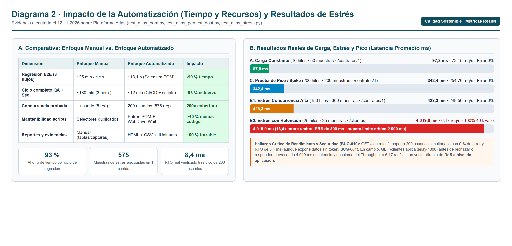

**Hallazgo técnico clave de `EST-03`:** al ejecutar 25 peticiones concurrentes sin token contra `GET /clientes`, el servidor responde `HTTP 401` (protege el recurso, a diferencia de `/contratos/1`), **pero ejecuta `delay(4000)` antes de rechazar**, reteniendo cada conexión durante **4.019 ms** y desplomando el Throughput a **6,17 req/s**. Esto demuestra un vector real de **Denegación de Servicio a nivel de aplicación (App-Layer DoS)** que puede saturar el servidor incluso sin autenticación.

### 5.4. Criticidad de incidentes y escala de impacto

Se aplica la escala de 4 niveles (**CRÍTICO**, **GRAVE**, **MODERADO**, **LEVE**) consolidando los incidentes detectados en el análisis estático, dinámico y DAST:

| ID Incidente | Descripción del Defecto / Vulnerabilidad | Evidencia | Impacto |
|---|---|---|---|
| `BUG-001` | Endpoints accesibles sin token (IDOR): `/contratos/:id`, `/usuarios/:id`, `/auditoria`, `/roles`, `/empresa-usuarios/:id` | `CP-011`, `PENT-01` (`HTTP 200` sin token) | **CRÍTICO** |
| `BUG-002` | Contraseñas en texto claro (`auth.js:26`) y credenciales por defecto (`admin/admin`, `editor/editor`) | Revisión código, `dump-atlas.sql:344-345` | **CRÍTICO** |
| `BUG-003` | Subida de archivos sin filtro (`multer` sin `fileFilter`); acepta `.exe` y `.html` XSS, violando `RF-5.2` | `CP-010`, `PENT-04`, `PENT-05` (`HTTP 201`) | **CRÍTICO** |
| `BUG-011` | Credenciales PostgreSQL hardcodeadas en `BACKEND/src/db.js:6` (`secrets:S6698`) | SonarQube 10.6 (BLOCKER), Gitleaks | **CRÍTICO** |
| `BUG-004` | `JWT_SECRET` con valor de respaldo `"inseguro"` en 7 routers | Revisión código (`auth.js:7`) | **GRAVE** |
| `BUG-005` | CORS global `Access-Control-Allow-Origin: *` (`app.js:22`) | `SEG-12`, OWASP ZAP (Alerta Alta), SonarQube | **GRAVE** |
| `BUG-006` | Ausencia de *rate-limit* y bloqueo por fuerza bruta en `/autenticacion/login` | `SEG-13`, `PENT-02` (sin `HTTP 429`) | **GRAVE** |
| `BUG-007` | Errores 500 exponen detalle interno de PostgreSQL (`glosa`); creaciones no transaccionales (*race conditions*) | `SEG-07b`, revisión código SQL | **GRAVE** |
| `BUG-008` | Token JWT y datos de usuario almacenados en `localStorage` (`AuthContext.jsx:8-16`) | Revisión código + OWASP ZAP (sin CSP) | **GRAVE** |
| `BUG-010` | Latencia artificial `delay(4000)` en login, clientes, contratos y métricas (App-Layer DoS) | `CP-013` (4,011 s), `EST-03` (4,019 s / 6,17 req/s) | **GRAVE** |
| `BUG-013` | Ausencia de cabeceras HTTP de endurecimiento (`Helmet`: `X-Frame-Options`, `nosniff`, `CSP`) y Swagger público | OWASP ZAP (`reporte_dast_zap_atlas.html`) | **GRAVE** |
| `BUG-012` | Contraste insuficiente en botón "Entrar" (2,39:1), `<html lang="en">` y campos sin mensaje de error visible | `CP-014` (Lighthouse 0,96 / WCAG) | **MODERADO** |
| `BUG-009` | Code smells ESLint (14 issues) y deuda técnica SonarQube (198 code smells, complejidad cognitiva 26) | ESLint 9, SonarQube 10.6 | **LEVE** |

---

## 6. Propuesta de mejora y Plan de Mantenimiento

### 6.1. Propuestas de mitigación priorizadas a defectos identificados

| ID | Defecto | Impacto | Propuesta de Remediación Técnica Concreta |
|---|---|---|---|
| `BUG-001` | IDOR / Endpoints sin autenticación | **CRÍTICO** | Implementar middleware global `authenticateJWT` + autorización RBAC (`admin`/`editor`) y validación de `empresa_id` en todos los routers (`contracts.js`, `users.js`, `audit.js`, `roles.js`, `empresa_usuarios.js`). |
| `BUG-002` / `004` / `011` | Credenciales en texto claro y secretos en código | **CRÍTICO** | Migrar contraseñas a `bcrypt` (coste ≥ 12), eliminar usuarios por defecto en producción, retirar credenciales de `db.js:6` y `JWT_SECRET` por defecto, exigiendo variables de entorno validadas al arranque y bloqueadas con `Gitleaks` en CI. |
| `BUG-003` | Carga irrestricta de `.exe` y `.html` (`RF-5.2`) | **CRÍTICO** | Configurar `multer` con `fileFilter`, límite de tamaño (`limits.fileSize`) y verificación de *magic bytes* restringida estrictamente a los 5 formatos de `RF-5.2` (PDF, DOC, PPT, JPG, PNG); alinear mensajes del frontend y servir descargas con `Content-Disposition: attachment` y `X-Content-Type-Options: nosniff`. |
| `BUG-005` / `013` | CORS `*` y ausencia de cabeceras seguras | **GRAVE** | Instalar y configurar `helmet()` en `BACKEND/src/app.js` (activando `X-Frame-Options`, `nosniff` y `CSP`), restringir `cors({ origin: process.env.ALLOWED_ORIGIN })` y proteger `/docs/` por entorno. Mitiga > 70 % de alertas DAST. |
| `BUG-006` / `008` | Fuerza bruta y JWT en `localStorage` | **GRAVE** | Incorporar `express-rate-limit` (p. ej. 5 intentos / 15 min) con respuesta `HTTP 429` y migrar el JWT a cookies `httpOnly; Secure; SameSite=Strict` con token Anti-CSRF. |
| `BUG-007` / `010` | `delay(4000)`, sin transacciones y fuga en 500 | **GRAVE** | Eliminar todas las llamadas `delay(4000)`, parametrizar `pg.Pool` (`max`, `idleTimeoutMillis`), envolver operaciones multi-tabla en `BEGIN ... COMMIT` (garantizando `RPO = 0`) y devolver mensajes de error genéricos con `traceId`. |
| `BUG-012` / `009` | Accesibilidad WCAG y deuda técnica | **MOD / LEVE** | Ajustar contraste del botón principal a ≥ 4,5:1, corregir `<html lang="es">`, renderizar `formState.errors`, resolver los 14 issues ESLint y refactorizar `ClienteForm.jsx` (complejidad cognitiva 26 → ≤ 15). |

### 6.2. Análisis del Plan de Mantenimiento del software (ISO/IEC 14764) para preservar calidad, seguridad y cumplimiento normativo

Un proceso de pruebas puntual no basta si el software se degrada en las siguientes iteraciones. Conforme a la norma **ISO/IEC 14764 (Mantenimiento del Software)** y a las características de **Mantenibilidad y Seguridad de ISO/IEC 25010**, se diseña un **Plan de Mantenimiento en cuatro frentes** para garantizar la continuidad de la calidad, la seguridad y el cumplimiento regulatorio de Atlas durante todo su ciclo de vida:

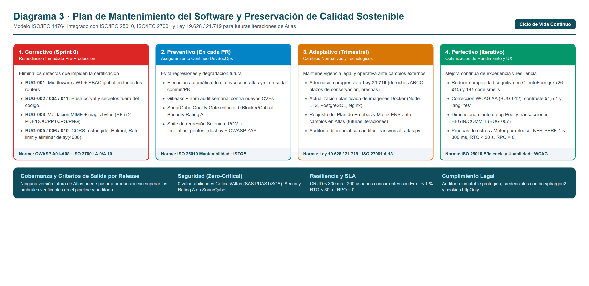

| Tipo de Mantenimiento (ISO/IEC 14764) | Objetivo en el Ciclo de Vida de Atlas | Actividades Concretas y Cadencia | Estándar / Normativa Preservada |
|---|---|---|---|
| **1. Mantenimiento Correctivo** | Eliminar los defectos que hoy bloquean la certificación antes de pasar a producción. | **Sprint 0 (Inmediato):** remediar los 4 Críticos (`BUG-001`, `BUG-002`, `BUG-003`, `BUG-011`) y 7 Graves (`BUG-004`..`BUG-013`). Re-ejecutar `test_atlas.sh`, `test_atlas_pentest_dast.py` y OWASP ZAP para verificar cierre real. | OWASP Top 10 (`A01`–`A08`) · ISO 27001 (`A.9.4`, `A.10`) · `RF-5.2` |
| **2. Mantenimiento Preventivo** | Detectar regresiones, vulnerabilidades nuevas y deuda técnica antes de que lleguen a producción. | **Continuo (en cada PR / semanal):** ejecución obligatoria de `ci-devsecops-atlas.yml` (`Gitleaks`, `npm audit`, `ESLint`, `SonarQube` Quality Gate con Security Rating A y deuda < 5 %, `Selenium POM` y `OWASP ZAP`). | ISO 25010 (Mantenibilidad/Seguridad) · ISTQB · ISO/IEC/IEEE 29119 |
| **3. Mantenimiento Adaptativo** | Ajustar el software y el plan de pruebas ante cambios legales, tecnológicos o de requerimientos. | **Trimestral o por cambio de alcance:** adecuación progresiva a **Ley 21.719** (derechos ARCO, retención de datos, registro de incidentes), actualización de contenedores base (Node LTS, PostgreSQL 17, Nginx) y ejecución de `auditor_transversal_atlas.py` para detectar *diffs* y nuevas fallas en iteraciones futuras. | Ley 19.628 y Ley 21.719 · ISO 27001 (`A.18.1`) |
| **4. Mantenimiento Perfectivo** | Optimizar rendimiento, resiliencia, accesibilidad y mantenibilidad del código. | **Por release:** reducir complejidad cognitiva (`ClienteForm.jsx`) y los 181 code smells del frontend, corregir WCAG AA (`BUG-012`), ajustar `pg.Pool` y correr `Atlas_Stress_Test_JMeter.jmx` validando `NFR-PERF-1` (< 300 ms), `NFR-PERF-3` (200 usuarios), **RTO < 30 s** y **RPO = 0**. | ISO 25010 (Eficiencia, Fiabilidad, Usabilidad) · WCAG 2.1 AA |

**Gobernanza y métricas de calidad sostenible por release:**
1. **Security Gate:** 0 vulnerabilidades Críticas o Altas en SAST/DAST/SCA; Security Rating **A** en SonarQube.
2. **Quality Gate:** Cobertura de código ≥ 80 % en módulos críticos (`auth`, `clients`, `contracts`), deuda técnica < 5 % y 100 % de la suite POM en verde.
3. **Resilience Gate:** Latencia CRUD < 300 ms, error < 1 % bajo carga de 200 usuarios, RTO < 30 s y RPO = 0.
4. **Compliance Gate:** Auditoría de acceso protegida, contraseñas con hash seguro, cookies `httpOnly` y documentación actualizada en cada versión.

### 6.3. Dictamen técnico final y consideraciones éticas/normativas

- **Consideraciones éticas:** todas las pruebas de penetración, DAST y estrés se ejecutaron exclusivamente sobre el laboratorio Docker local con datos sintéticos, sin alterar el código fuente para ocultar hallazgos y con divulgación responsable y evidencia verificable.
- **Consideraciones normativas:** mientras permanezcan abiertos `BUG-001` (acceso sin token), `BUG-002` (texto claro) y `BUG-003` (subida de ejecutables/XSS), Atlas incumple controles esenciales de **ISO/IEC 27001** y principios de confidencialidad y seguridad de la **Ley 19.628 / Ley 21.719**.
- **Dictamen final:** **SISTEMA NO CERTIFICADO.** Permanecen abiertos **4 incidentes CRÍTICOS** y **7 GRAVES**, junto con Security Rating **E** en backend y 5 alertas DAST activas. Sin embargo, el equipo deja implementado el **ecosistema completo de aseguramiento continuo** (pipeline CI/CD DevSecOps, suite automatizada Selenium POM, scripts de Pentesting/DAST, plan JMeter de estrés y Plan de Mantenimiento ISO/IEC 14764) para certificar la siguiente iteración una vez aplicadas las remediaciones del Sprint 0.

---

## 7. Anexos y evidencias técnicas reproducibles

### Anexo A · Bitácora de ejecución

Las tablas de este anexo son una **síntesis** de la ejecución. La petición `curl` y la respuesta HTTP completa de cada caso están transcritas en el Anexo F; no se registra ningún resultado sin evidencia.

**Ciclo 1 · Smoke Test** (objetivo: verificar funciones base; si falla, se detiene la ejecución)

| ID | Nombre | Fecha | Ejecutor | Estado | Defecto | Observaciones |
|---|---|---|---|---|---|---|
| CP-001 | Login con credenciales válidas (admin/admin) | 28-10-2026 | Miguel Arredondo | Aprueba | N/A | HTTP 200, JWT de 233 caracteres |
| CP-002 | Login con contraseña incorrecta | 28-10-2026 | Miguel Arredondo | Aprueba | N/A | HTTP 401 "Credenciales inválidas". No enumera usuarios |
| CP-003 | Estado/salud de la API | 28-10-2026 | Miguel Arredondo | Aprueba | N/A | HTTP 200 `{"name":"Atlas","status":"ok"}` |
| CP-004 | Documentación Swagger `/docs/` | 28-10-2026 | Miguel Arredondo | Aprueba | N/A | HTTP 200 (interfaz interactiva) |

**Ciclo 2 · Ejecución de casos de prueba**

| ID | Nombre | Fecha | Ejecutor | Estado | Defecto | Observaciones |
|---|---|---|---|---|---|---|
| CP-005 | Listar clientes (token) | 28-10-2026 | Miguel Arredondo | Aprueba | N/A | HTTP 200; 4 clientes en la captura |
| CP-006 | Crear cliente | 28-10-2026 | Miguel Arredondo | Aprueba | N/A | HTTP 201; cliente ID 5 "Cliente Evidencia …" |
| CP-007 | Buscar cliente por nombre | 28-10-2026 | Miguel Arredondo | Aprueba | N/A | HTTP 200; el cliente creado aparece en la búsqueda |
| CP-008 | Listar contratos (token) | 28-10-2026 | Miguel Arredondo | Aprueba | N/A | HTTP 200; 8 contratos en la captura |
| CP-009 | Dashboard / métricas (token) | 28-10-2026 | Miguel Arredondo | Aprueba | N/A | HTTP 200; 2 usuarios, 5 clientes |
| CP-010 | Subir documento a contrato (`.exe` y `.html`) | 28-10-2026 | Luis Tasso | Falló | BUG-003 | HTTP 201: se aceptaron ejecutable y HTML sin validación |
| CP-011 | Acceso a contrato SIN token (`GET /contratos/1`) | 28-10-2026 | Luis Tasso | Falló | BUG-001 | HTTP 200 devuelve datos del contrato sin autenticación |
| CP-012 | Login con intento SQLi (`admin' OR '1'='1`) | 28-10-2026 | Luis Tasso | Aprueba | N/A | HTTP 401; consulta parametrizada lo bloquea |
| CP-013 | Rendimiento de `GET /clientes` (5 mediciones) | 28-10-2026 | Nicolas Iturrieta | Falló | BUG-010 | Promedio 4,011 s vs. umbral 0,300 s |
| CP-014 | Usabilidad y accesibilidad del login | 28-10-2026 | Nicolas Iturrieta | Aprueba con observaciones | BUG-012 | Lighthouse 0,96; contraste 2,39:1 y `lang="en"` |

### Anexo B · Evidencias de seguridad (pruebas complementarias)

Igual que el Anexo A, esta tabla es una síntesis: la columna "Evidencia" indica el bloque del Anexo F donde se transcribe la petición y la respuesta real de cada prueba.

| ID Prueba | Prueba | Resultado esperado | Resultado obtenido | Severidad | Evidencia (Anexo F) |
|---|---|---|---|---|---|
| SEG-01 | `GET /contratos/1` y descarga de archivo sin token | 401 | **200 (contrato y archivo con contenido `.exe`)** | Crítica | SEG-01 |
| SEG-02 | `GET /usuarios/1` sin token | 401 | **200 (correo de usuario)** | Crítica | SEG-02 |
| SEG-03 | `GET /auditoria` sin token | 401 | **200 (logs internos)** | Crítica | SEG-03 |
| SEG-04 | `GET /roles` sin token | 401 | **200** | Mayor | SEG-04 |
| SEG-05 | Login con payload SQLi (`admin' OR '1'='1`) | 401 | 401 (consulta parametrizada) | Conforme | SEG-05 |
| SEG-06 | Login con contraseña incorrecta (sin enumeración) | 401 | 401 | Conforme | SEG-06 |
| SEG-07b | Subir archivo `.exe` y `.html` con token | Rechazo 400/415 | **201 (aceptado)** | Crítica | SEG-07b |
| SEG-10 | Acceso con token válido a recurso propio | 200 | 200 | Conforme | SEG-10 |
| SEG-12 | `Origin: http://evil.example.com` | Origen restringido | **`Access-Control-Allow-Origin: *`** | Mayor | SEG-12 |
| SEG-13 | 3 intentos de login fallidos seguidos | Bloqueo/rate-limit | Ningún bloqueo (solo 4 s de espera) | Mayor | SEG-13 |

**Total: 10 pruebas SEG — 7 inseguras (SEG-01, SEG-02, SEG-03, SEG-04, SEG-07b, SEG-12, SEG-13) y 3 conformes (SEG-05, SEG-06, SEG-10).**

> Las pruebas SEG-08b y SEG-11a se integran como evidencia dentro de SEG-07b y SEG-01, respectivamente. SEG-09 corresponde al hallazgo de `JWT_SECRET` detectado por revisión manual (BUG-004) y no se contabiliza como prueba dinámica independiente. CP-013 (rendimiento) y CP-014 (usabilidad) son casos no funcionales y se registran en el Anexo A, no como SEG.

### Anexo C · Análisis estático de código (ESLint 9)

**Frontend (11 issues en 7 archivos):**

| Archivo | Línea | Tipo | Regla |
|---|---|---|---|
| `pages/clientes/ClientesTabList.jsx` | 27 | Error | no-unused-vars (`onLoad`) |
| `pages/contratos/ContratosTabCreate.jsx` | 31 | Error | no-unused-vars (`error`) |
| `pages/contratos/ContratosTabList.jsx` | 32 / 244 | Error / Warning | no-unused-vars / react-hooks/exhaustive-deps |
| `pages/empresas/EmpresaForm.jsx` | 42 / 63 | Error | no-unused-vars (`error`) |
| `pages/empresas/EmpresasList.jsx` | 43 | Warning | Unused eslint-disable directive |
| `pages/usuarios/UsuarioForm.jsx` | 43 / 61 / 86 | Error | no-unused-vars (`error`) |
| `pages/usuarios/UsuariosTabList.jsx` | 28 | Warning | react-hooks/exhaustive-deps |

**Backend (3 issues):**

| Archivo | Línea | Tipo | Regla |
|---|---|---|---|
| `src/app.js` | 8 | Warning | no-unused-vars (`pool` importado sin uso) |
| `src/routes/contracts.js` | 1–2 | Warning | no-unused-vars (`path`, `fs`) |

**Hallazgos manuales de seguridad (código fuente):**

| Ubicación | Hallazgo | Severidad |
|---|---|---|
| `auth.js:7` y 7 routers | `JWT_SECRET` default `"inseguro"` | Mayor |
| `auth.js:26` | Comparación de contraseña en texto claro (`user.contrasena_hash !== password`) | Crítica |
| `app.js:22` | `app.use(cors())` sin configurar → `*` | Mayor |
| `contracts.js:29` | `multer({ storage })` sin filtro de archivos; archivo guardado como bytea sin validar | Crítica |
| `contracts.js:275,413` | `GET /:id` y `GET /:id/file` sin validación de token | Crítica |
| `users.js:74-90,123` | `GET /:id` y `DELETE /:id` sin validación de token/empresa | Crítica |
| `audit.js:37-45`, `roles.js:39-59`, `empresa_usuarios.js:132-149` | Lecturas sin autenticación | Mayor |
| `AuthContext.jsx:8-16` | Token y user en `localStorage` | Mayor |
| `dump-atlas.sql:344-345` | Credenciales por defecto `admin/admin`, `editor/editor` | Crítica |
| `db.js:6` | Credenciales de BD en cadena de conexión por defecto del código | Mayor |
| Errores 500 | Campo `glosa` expone mensaje interno de PostgreSQL | Menor |

### Anexo D · Ambiente de prueba

| Componente | Tecnología | Endpoint |
|---|---|---|
| Frontend Atlas | React 19 + Vite + MUI (nginx) | http://localhost:3350 |
| API Atlas | Node 18 + Express 4.19 | http://localhost:4450 |
| Base de datos | PostgreSQL 17 | localhost:15432 (nombre: `atlas`) |
| Documentación API | Swagger UI (`/docs/`) | http://localhost:4450/docs/ |
| Método de ejecución | Docker Compose (`docker compose up -d --build`) | — |
| Fecha de ejecución | 28-10-2026 | — |
| Ejecutores | Luis Tasso (seguridad), Miguel Arredondo (funcional), Nicolas Iturrieta (no funcional) | — |

### Anexo E · Análisis estático con SonarQube (servidor local :9000)

Se desplegó un servidor **SonarQube 10.6 Community** en Docker (`sonarqube:10.6-community`, puerto 9000) y se ejecutó el análisis con **Sonar Scanner 3.1** (Node, sin JVM adicional) sobre el backend y el frontend de Atlas.

**Métricas de calidad:**

| Métrica | Backend (`atlas`) | Frontend (`atlas-frontend`) |
|---|---|---|
| Líneas de código (ncloc) | 1.523 | 5.432 |
| Bugs | 0 | 1 |
| Vulnerabilidades | **1** | 0 |
| Code Smells | 17 | 181 |
| Security Hotspots | 4 | 0 |
| Duplicación (%) | 37,0 | 11,1 |
| Cobertura | 0 % (sin tests) | 0 % |
| Reliability Rating | A (1.0) | C (3.0) |
| Security Rating | **E (5.0)** | A (1.0) |
| Maintainability Rating | A (1.0) | A (1.0) |
| Quality Gate | OK | OK |

> El Security Rating E del backend confirma los problemas de seguridad críticos detectados en las pruebas dinámicas y en la revisión manual. El Quality Gate figura "OK" porque el Quality Gate por defecto solo evalúa bugs y deuda técnica; en las recomendaciones se incluye agregar condiciones de seguridad.

**Hallazgos relevantes de SonarQube:**

**Backend (`atlas`)**
- **Vulnerabilidad BLOCKER — `src/db.js:6` (secrets:S6698):** "Make sure this PostgreSQL database password gets changed and removed from the code." Confirma el hallazgo manual de credenciales de BD en la cadena de conexión por defecto.
- 16 Code Smells **MINOR** (`javascript:S6582`): preferir *optional chaining* en `clients.js`, `contracts.js`, `empresa_usuarios.js`, `metricas.js`.
- 1 Code Smell **MAJOR** (`users.js:44`, `javascript:S125`): código comentado.
- 4 Security Hotspots:
  - `contracts.js:14-15` (`dos`): "Make sure the content length limit is safe here" — límite de tamaño de upload no definido (relacionado con BUG-003).
  - `app.js:22` (`insecure-conf`): "Make sure that enabling CORS is safe here" (relacionado con BUG-005).
  - `app.js:20` (`others`): la plataforma expone la versión de Express por defecto.

**Frontend (`atlas-frontend`)**
- 1 **BUG MAJOR** (`src/index.css:6`, `css:S4649`): falta *generic font family* de respaldo.
- 1 **Code Smell CRITICAL** (`ClienteForm.jsx:63`, `javascript:S3776`): Complejidad cognitiva 26 vs 15 permitido.
- 181 Code Smells: 110 × validación de props (`S6774`), 45 × API deprecada (`S1874`, `*.findDOMNode`), 16 × definir componente dentro del padre (`S6478`), etc.
- 1 BUG de compatibilidad de React 19 (`findDOMNode` deprecado, relacionado con `S1874`).

**Comando usado (evidencia reproducible):**

```bash
# 1) Servidor SonarQube
docker run -d --name sonarqube -p 9000:9000 \
  -e SONAR_ES_BOOTSTRAP_CHECKS_DISABLE=true \
  -v sonarqube_data:/opt/sonarqube/data \
  -v sonarqube_logs:/opt/sonarqube/logs \
  -v sonarqube_extensions:/opt/sonarqube/extensions \
  sonarqube:10.6-community

# 2) Scan (en BACKEND/ y luego en FRONTEND/, con su sonar-project.properties)
sonar-scanner -Dsonar.host.url=http://localhost:9000 -Dsonar.token=TOKEN
```

**Conclusiones del análisis estático:** SonarQube encontró 1 vulnerabilidad de severidad Blocker (credenciales de PostgreSQL en código), 4 security hotspots que corresponden exactamente a los defectos BUG-003 y BUG-005 detectados en las pruebas dinámicas, y una deuda técnica de mantenibilidad importante en el frontend (181 code smells). Esto refuerza el dictamen **NO CERTIFICADO**.

**Evidencias (capturas de pantalla):**

**Dashboard Backend (atlas):**
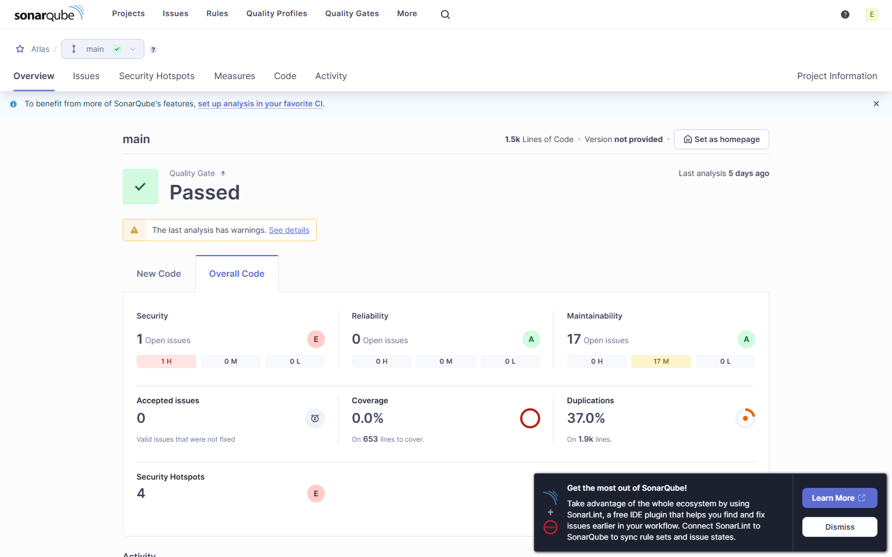

**Dashboard Frontend (atlas-frontend):**
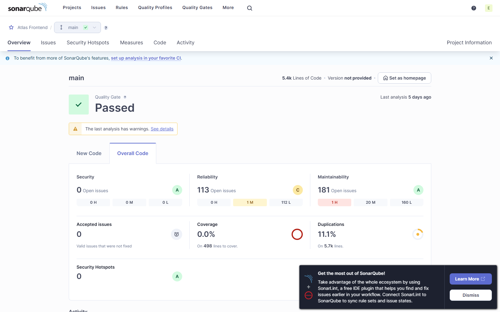

**Vulnerabilidad BLOCKER (db.js:6):**
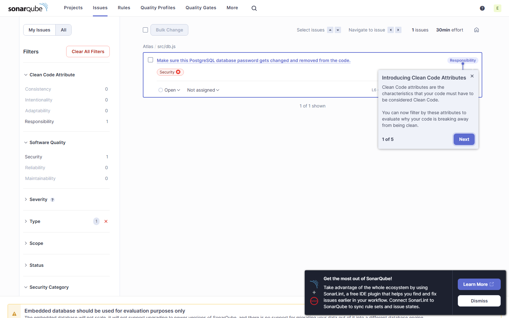

**Code Smells Backend:**
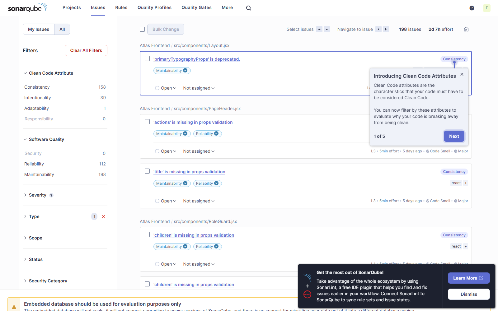

**Security Hotspots:**
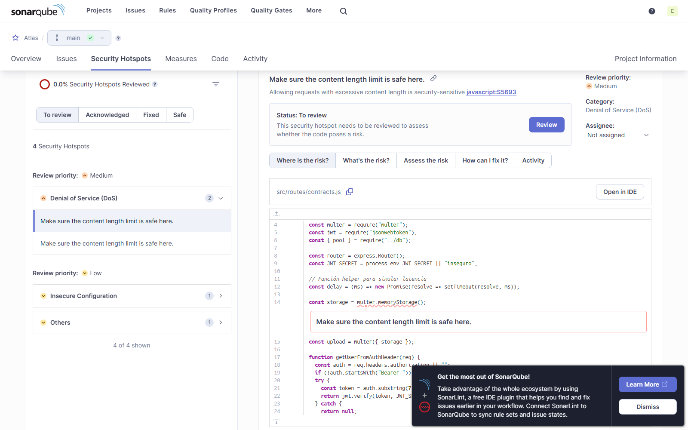

**Issues Frontend:**
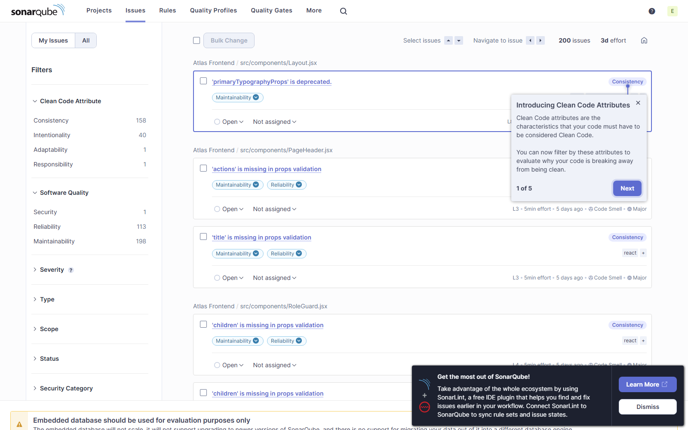

**Quality Gate (Sonar way):**
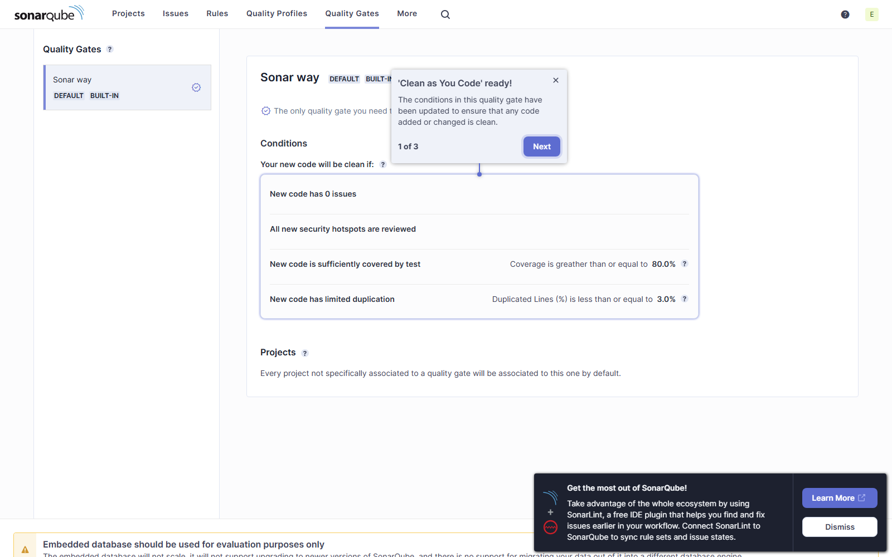

**Resumen de Proyectos:**
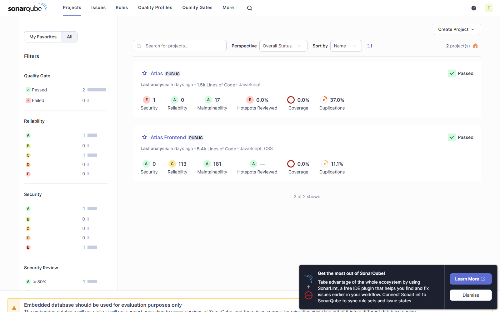

### Anexo F · Evidencias crudas de ejecución (petición y respuesta)

**Entorno y método.** Las capturas se realizaron el **28-10-2026** contra el despliegue Docker Compose local (API `http://localhost:4450`, frontend `http://localhost:3350`). Cada bloque muestra el comando `curl` ejecutado y la respuesta real del servidor: código y frase HTTP, cabeceras seleccionadas y cuerpo. Los cuerpos de más de 700 caracteres se truncan con la marca `… (salida truncada)`; el código HTTP, las cabeceras y el resultado se conservan completos. El token JWT se muestra truncado por seguridad y su longitud real se indica en el resultado.

**Trazabilidad:** el orden de los bloques coincide con las fichas de la sección 4.1 y con el detalle de ejecución de la sección 5.2. Las tablas de los Anexos A y B remiten a estos bloques.

---

```bash
API=http://localhost:4450
TOKEN=$(curl -s -X POST "$API/autenticacion/login" \
  -H "Content-Type: application/json" \
  -d '{"nombre_usuario":"admin","password":"admin"}' | jq -r .token)
```

**CP-001 · Login con credenciales válidas**

```bash
curl -s -i -X POST "$API/autenticacion/login" \
  -H "Content-Type: application/json" \
  -d '{"nombre_usuario":"admin","password":"admin"}'
```

```http
HTTP/1.1 200 OK
Content-Type: application/json; charset=utf-8
Content-Length: 245
Access-Control-Allow-Origin: *
X-Powered-By: Express

{
  "token": "eyJhbGciOiJIUzI1NiIsInR5…"
}
```

**Resultado:** Aprobado. HTTP 200 y JWT emitido (233 caracteres).

**CP-002 · Login con contraseña incorrecta**

```bash
curl -s -i -X POST "$API/autenticacion/login" \
  -H "Content-Type: application/json" \
  -d '{"nombre_usuario":"admin","password":"incorrecta"}'
```

```http
HTTP/1.1 401 Unauthorized
Content-Type: application/json; charset=utf-8
Content-Length: 35
Access-Control-Allow-Origin: *
X-Powered-By: Express

{
  "error": "Credenciales inválidas"
}
```

**Resultado:** Aprobado. HTTP 401 con mensaje genérico; no enumera usuarios.

**CP-003 · Estado de salud de la API**

```bash
curl -s -i "$API/"
```

```http
HTTP/1.1 200 OK
Content-Type: application/json; charset=utf-8
Content-Length: 30
Access-Control-Allow-Origin: *
X-Powered-By: Express

{
  "name": "Atlas",
  "status": "ok"
}
```

**Resultado:** Aprobado. HTTP 200 con `{"name":"Atlas","status":"ok"}`.

**CP-004 · Documentación Swagger**

```bash
curl -s -i -L "$API/docs/"
```

```http
HTTP/1.1 200 OK
Content-Type: text/html; charset=utf-8
Content-Length: 3106
Access-Control-Allow-Origin: *
X-Powered-By: Express


<!-- HTML for static distribution bundle build -->
<!DOCTYPE html>
<html lang="en">
<head>
  <meta charset="UTF-8">
  
  <title>Swagger UI</title>
  <link rel="stylesheet" type="text/css" href="./swagger-ui.css" >
  <link rel="icon" type="image/png" href="./favicon-32x32.png" sizes="32x32" /><link rel="icon" type="image/png" href="./favicon-16x16.png" sizes="16x16" />
  <style>
    html
    {
      box-sizing: border-box;
      overflow: -moz-scrollbars-vertical;
      overflow-y: scroll;
    }
    *,
    *:before,
    *:after
    {
      box-sizing: inherit;
    }

    body {
      margin:0;
      background: #fafafa;
    }
  </style>
</head>

<body>

<svg xmlns="http://www.w3.org/2000/svg
… (salida truncada)
```

**Resultado:** Aprobado. HTTP 200; interfaz Swagger disponible.

**CP-005 · Listar clientes con token**

```bash
curl -s -i "$API/clientes" \
  -H "Authorization: Bearer $TOKEN"
```

```http
HTTP/1.1 200 OK
Content-Type: application/json; charset=utf-8
Content-Length: 3163
Access-Control-Allow-Origin: *
X-Powered-By: Express

[
  {
    "id": "4",
    "nombre": "Cliente Prueba Script",
    "correo": "script@test.cl",
    "telefono": "111",
    "direccion": "Calle 1",
    "es_empresa": false,
    "rut": null,
    "nombre_fantasia": null,
    "giro_actividad_economica": null,
    "nombre_representante": null,
    "cargo_representante": null,
    "correo_representante": null,
    "telefono_representante": null,
    "relacion_representante": null,
    "direccion_calle": null,
    "direccion_numero": null,
    "direccion_ciudad": null,
    "direccion_region": null,
    "sitio_web": null,
    "telefono_corporativo": null,
    "nombre_banco": null,
    "numero_cuenta": null,
    "titular_cuenta": null,
    "metodo_pago":
… (salida truncada)
```

**Resultado:** Aprobado. HTTP 200; lista de clientes de la empresa.

**CP-006 · Crear cliente**

```bash
curl -s -i -X POST "$API/clientes" \
  -H "Authorization: Bearer $TOKEN" \
  -H "Content-Type: application/json" \
  -d '{"nombre":"Cliente Evidencia 1793227468","correo":"evidencia@test.cl","telefono":"999999999","direccion":"Av. Evidencia 1","es_empresa":false}'
```

```http
HTTP/1.1 201 Created
Content-Type: application/json; charset=utf-8
Content-Length: 669
Access-Control-Allow-Origin: *
X-Powered-By: Express

{
  "id": "5",
  "nombre": "Cliente Evidencia 1793227468",
  "correo": "evidencia@test.cl",
  "telefono": "999999999",
  "direccion": "Av. Evidencia 1",
  "es_empresa": false,
  "rut": null,
  "nombre_fantasia": null,
  "giro_actividad_economica": null,
  "nombre_representante": null,
  "cargo_representante": null,
  "correo_representante": null,
  "telefono_representante": null,
  "relacion_representante": null,
  "direccion_calle": null,
  "direccion_numero": null,
  "direccion_ciudad": null,
  "direccion_region": null,
  "sitio_web": null,
  "telefono_corporativo": null,
  "nombre_banco": null,
  "numero_cuenta": null,
  "titular_cuenta": null,
  "metodo_pago": null,
  "dia_pago": null,
 
… (salida truncada)
```

**Resultado:** Aprobado. HTTP 201; cliente creado: Cliente Evidencia 1793227468.

**CP-007 · Buscar cliente por nombre**

```bash
curl -s -i "$API/clientes/search?name=Evidencia" \
  -H "Authorization: Bearer $TOKEN"
```

```http
HTTP/1.1 200 OK
Content-Type: application/json; charset=utf-8
Content-Length: 671
Access-Control-Allow-Origin: *
X-Powered-By: Express

[
  {
    "id": "5",
    "nombre": "Cliente Evidencia 1793227468",
    "correo": "evidencia@test.cl",
    "telefono": "999999999",
    "direccion": "Av. Evidencia 1",
    "es_empresa": false,
    "rut": null,
    "nombre_fantasia": null,
    "giro_actividad_economica": null,
    "nombre_representante": null,
    "cargo_representante": null,
    "correo_representante": null,
    "telefono_representante": null,
    "relacion_representante": null,
    "direccion_calle": null,
    "direccion_numero": null,
    "direccion_ciudad": null,
    "direccion_region": null,
    "sitio_web": null,
    "telefono_corporativo": null,
    "nombre_banco": null,
    "numero_cuenta": null,
    "titular_cuenta": 
… (salida truncada)
```

**Resultado:** Aprobado. HTTP 200; el cliente creado aparece en la búsqueda.

**CP-008 · Listar contratos con token**

```bash
curl -s -i "$API/contratos" \
  -H "Authorization: Bearer $TOKEN"
```

```http
HTTP/1.1 200 OK
Content-Type: application/json; charset=utf-8
Content-Length: 1830
Access-Control-Allow-Origin: *
X-Powered-By: Express

[
  {
    "id": "8",
    "titulo": "Contrato evidencia",
    "descripcion": null,
    "fecha_inicio": "2026-01-01T00:00:00.000Z",
    "fecha_fin": "2026-12-31T00:00:00.000Z",
    "created_at": "2026-10-28T22:43:41.040Z",
    "cliente_nombre": "María González"
  },
  {
    "id": "7",
    "titulo": "Contrato prueba exe",
    "descripcion": null,
    "fecha_inicio": "2026-01-01T00:00:00.000Z",
    "fecha_fin": "2026-12-31T00:00:00.000Z",
    "created_at": "2026-10-03T00:51:14.015Z",
    "cliente_nombre": "María González"
  },
  {
    "id": "6",
    "titulo": "Contrato HTML v2",
    "descripcion": null,
    "fecha_inicio": "2026-01-01T00:00:00.000Z",
    "fecha_fin": "2026-12-31T00:00:00.000Z",

… (salida truncada)
```

**Resultado:** Aprobado. HTTP 200; contratos de la empresa.

**CP-009 · Dashboard / métricas**

```bash
curl -s -i "$API/contratos/dashboard" \
  -H "Authorization: Bearer $TOKEN"
```

```http
HTTP/1.1 200 OK
Content-Type: application/json; charset=utf-8
Content-Length: 114
Access-Control-Allow-Origin: *
X-Powered-By: Express

{
  "totalUsuarios": 2,
  "totalClientes": 5,
  "contratosVencen7Dias": 0,
  "contratosVencen15Dias": 0,
  "contratosVencen30Dias": 0
}
```

**Resultado:** Aprobado. HTTP 200; métricas del dashboard.

**CP-010 · Subida de archivo no permitido (.exe)**

```bash
printf 'MZ fake exe content' > evidencia.exe
curl -s -i -X POST "$API/contratos" \
  -H "Authorization: Bearer $TOKEN" \
  -F "cliente_id=1" -F "titulo=Contrato evidencia el ciclo anterior" \
  -F "fecha_inicio=2026-01-01" -F "fecha_fin=2026-12-31" \
  -F "file=@evidencia.exe"
```

```http
HTTP/1.1 201 Created
Content-Type: application/json; charset=utf-8
Content-Length: 201
Access-Control-Allow-Origin: *
X-Powered-By: Express

{
  "id": "9",
  "cliente_id": "1",
  "titulo": "Contrato evidencia el ciclo anterior",
  "descripcion": null,
  "fecha_inicio": "2026-01-01T00:00:00.000Z",
  "fecha_fin": "2026-12-31T00:00:00.000Z",
  "created_at": "2026-10-28T22:44:33.064Z"
}
```

**Resultado:** **FALLÓ.** HTTP 201: el `.exe` fue aceptado y almacenado (contrato ID 9) — BUG-003.

**CP-011 · Acceso a contrato sin token (IDOR)**

```bash
curl -s -i "$API/contratos/1"
```

```http
HTTP/1.1 200 OK
Content-Type: application/json; charset=utf-8
Content-Length: 239
Access-Control-Allow-Origin: *
X-Powered-By: Express

{
  "id": "1",
  "cliente_id": "1",
  "titulo": "Contrato de Servicios",
  "descripcion": "Contrato de servicios de Biotec Solutions",
  "fecha_inicio": "2026-01-01T00:00:00.000Z",
  "fecha_fin": "2026-12-31T00:00:00.000Z",
  "created_at": "2026-09-24T22:43:44.731Z"
}
```

**Resultado:** **FALLÓ.** HTTP 200 con datos del contrato sin autenticación — BUG-001.

**CP-012 · Intento de inyección SQL en login**

```bash
curl -s -i -X POST "$API/autenticacion/login" \
  -H "Content-Type: application/json" \
  -d "{\"nombre_usuario\":\"admin' OR '1'='1\",\"password\":\"x\"}"
```

```http
HTTP/1.1 401 Unauthorized
Content-Type: application/json; charset=utf-8
Content-Length: 35
Access-Control-Allow-Origin: *
X-Powered-By: Express

{
  "error": "Credenciales inválidas"
}
```

**Resultado:** Aprobado. HTTP 401; la consulta parametrizada bloquea la inyección.

**CP-013 · Rendimiento de `GET /clientes` (5 mediciones)**

```bash
for i in 1 2 3 4 5; do
  curl -s -o /dev/null -w "%{time_total}\n" "$API/clientes" \
    -H "Authorization: Bearer $TOKEN"
done
```

| Medición | Tiempo | HTTP |
|---|---|---|
| 1 | 4.010 s | 200 |
| 2 | 4.013 s | 200 |
| 3 | 4.010 s | 200 |
| 4 | 4.011 s | 200 |
| 5 | 4.011 s | 200 |
| **Promedio** | **4.011 s** | 200 |
| **Mínimo** | 4.010 s | 200 |
| **Máximo** | 4.013 s | 200 |

**Resultado:** **FALLÓ.** Promedio 4.011 s frente al umbral NFR-PERF-1 de 0,300 s — BUG-010.


**CP-014 · Usabilidad y accesibilidad del login (revisión con Chromium y Lighthouse)**

No es una prueba de API, por lo que no se ejecuta con `curl`. La evidencia se obtuvo con el navegador Chromium sobre `http://localhost:3350/login` y una auditoría Lighthouse 12:

```text
document.documentElement.lang  = "en"          (contenido en español)
getComputedStyle(body).fontSize = "14px"       (≥ 12 px exigidos)
Botón "Entrar": fondo #4BBC7F, texto #FFFFFF  -> contraste 2,39:1 (AA exige 4,5:1)
document.documentElement.scrollWidth = 1000 px = innerWidth  (sin desbordamiento)
Etiquetas: <label for="nombre_usuario">, <label for="password">  (asociadas)
Lighthouse 12: accessibility 0.96 · best-practices 1.00 · SEO 0.67
Fallo automático: color-contrast (button[type=submit])
```

| N.º | Criterio | Resultado |
|---|---|---|
| 1 | Tipografía ≥ 12 px | Cumple (14 px) |
| 2 | Contraste AA | No cumple (2,39:1) |
| 3 | Etiquetas asociadas | Cumple |
| 4 | Idioma declarado | No cumple (`lang="en"`) |
| 5 | Mensajes de error claros | Parcial (toast genérico; sin mensaje en campos vacíos) |
| 6 | Sin desbordamiento horizontal | Cumple |

**Resultado:** **Aprobado con observaciones.** Lighthouse 0,96 ≥ 0,90; se registran BUG-012 (contraste, idioma, validación) y la verificación manual pendiente del foco visible.

**SEG-01 · IDOR: contrato y archivo sin token**

```bash
curl -s -i "$API/contratos/1"
curl -s -i "$API/contratos/9/file"
```

```http
HTTP/1.1 200 OK
Content-Type: application/pdf
Content-Length: 19
Access-Control-Allow-Origin: *
Content-Disposition: inline; filename="contrato.pdf"
X-Powered-By: Express

MZ fake exe content
```

**Resultado:** **INSEGURO.** HTTP 200 y descarga del archivo sin token; `Content-Type: application/pdf` con contenido `.exe` (contrato 9).

**SEG-02 · IDOR: usuario sin token**

```bash
curl -s -i "$API/usuarios/1"
```

```http
HTTP/1.1 200 OK
Content-Type: application/json; charset=utf-8
Content-Length: 106
Access-Control-Allow-Origin: *
X-Powered-By: Express

{
  "id": "1",
  "nombre_usuario": "admin",
  "correo": "admin@atlasfake.com",
  "created_at": "2026-09-24T22:43:44.712Z"
}
```

**Resultado:** **INSEGURO.** HTTP 200 con datos del usuario sin token.

**SEG-03 · IDOR: auditoría sin token**

```bash
curl -s -i "$API/auditoria"
```

```http
HTTP/1.1 200 OK
Content-Type: application/json; charset=utf-8
Content-Length: 2328
Access-Control-Allow-Origin: *
X-Powered-By: Express

[
  {
    "id": "21",
    "usuario_id": "admin",
    "accion": "CONTRATOS_CREAR: creó contrato Contrato evidencia el ciclo anterior para cliente 1",
    "fecha_hora": "2026-10-28T22:44:33.075Z"
  },
  {
    "id": "20",
    "usuario_id": "admin",
    "accion": "CLIENTES_CREAR: creó cliente Cliente Evidencia 1793227468",
    "fecha_hora": "2026-10-28T22:44:28.952Z"
  },
  {
    "id": "19",
    "usuario_id": "admin",
    "accion": "LOGIN: usuario inició sesión",
    "fecha_hora": "2026-10-28T22:44:20.878Z"
  },
  {
    "id": "18",
    "usuario_id": "admin",
    "accion": "CONTRATOS_CREAR: creó contrato Contrato evidencia para cliente 1",
    "fecha_hora": "2026-10-28T22:43:41.057Z"
  },
  {
    "id": "17",
 
… (salida truncada)
```

**Resultado:** **INSEGURO.** HTTP 200 con registros de auditoría sin token.

**SEG-04 · IDOR: roles sin token**

```bash
curl -s -i "$API/roles"
```

```http
HTTP/1.1 200 OK
Content-Type: application/json; charset=utf-8
Content-Length: 66
Access-Control-Allow-Origin: *
X-Powered-By: Express

[
  {
    "id": "2",
    "nombre": "editor"
  },
  {
    "id": "1",
    "nombre": "administrador"
  }
]
```

**Resultado:** **INSEGURO.** HTTP 200 con el listado de roles sin token.

**SEG-05 · Inyección SQL en login**

```bash
curl -s -i -X POST "$API/autenticacion/login" \
  -H "Content-Type: application/json" \
  -d "{\"nombre_usuario\":\"admin' OR '1'='1\",\"password\":\"x\"}"
```

```http
HTTP/1.1 401 Unauthorized
Content-Type: application/json; charset=utf-8
Content-Length: 35
Access-Control-Allow-Origin: *
X-Powered-By: Express

{
  "error": "Credenciales inválidas"
}
```

**Resultado:** **CONFORME.** HTTP 401; consulta parametrizada.

**SEG-06 · Login inválido sin enumeración**

```bash
curl -s -i -X POST "$API/autenticacion/login" \
  -H "Content-Type: application/json" \
  -d '{"nombre_usuario":"admin","password":"incorrecta"}'
```

```http
HTTP/1.1 401 Unauthorized
Content-Type: application/json; charset=utf-8
Content-Length: 35
Access-Control-Allow-Origin: *
X-Powered-By: Express

{
  "error": "Credenciales inválidas"
}
```

**Resultado:** **CONFORME.** HTTP 401 con mensaje genérico.

**SEG-07b · Subida de .exe y .html**

```bash
curl -s -i -X POST "$API/contratos" \
  -H "Authorization: Bearer $TOKEN" \
  -F "cliente_id=1" -F "titulo=Contrato evidencia" \
  -F "fecha_inicio=2026-01-01" -F "fecha_fin=2026-12-31" \
  -F "file=@evidencia.exe"
# y el mismo comando con evidencia.html
```

```http
HTTP/1.1 201 Created
Content-Type: application/json; charset=utf-8
Content-Length: 203
Access-Control-Allow-Origin: *
X-Powered-By: Express

{
  "id": "10",
  "cliente_id": "1",
  "titulo": "Contrato evidencia HTML",
  "descripcion": null,
  "fecha_inicio": "2026-01-01T00:00:00.000Z",
  "fecha_fin": "2026-12-31T00:00:00.000Z",
  "created_at": "2026-10-28T22:45:05.327Z"
}
```

**Resultado:** **INSEGURO.** HTTP 201: el `.html` también fue aceptado (el `.exe` se aceptó en CP-010) — BUG-003.

**SEG-10 · Acceso con token válido a recurso propio**

```bash
curl -s -i "$API/clientes" \
  -H "Authorization: Bearer $TOKEN"
```

```http
HTTP/1.1 200 OK
Content-Type: application/json; charset=utf-8
Content-Length: 3833
Access-Control-Allow-Origin: *
X-Powered-By: Express

[
  {
    "id": "5",
    "nombre": "Cliente Evidencia 1793227468",
    "correo": "evidencia@test.cl",
    "telefono": "999999999",
    "direccion": "Av. Evidencia 1",
    "es_empresa": false,
    "rut": null,
    "nombre_fantasia": null,
    "giro_actividad_economica": null,
    "nombre_representante": null,
    "cargo_representante": null,
    "correo_representante": null,
    "telefono_representante": null,
    "relacion_representante": null,
    "direccion_calle": null,
    "direccion_numero": null,
    "direccion_ciudad": null,
    "direccion_region": null,
    "sitio_web": null,
    "telefono_corporativo": null,
    "nombre_banco": null,
    "numero_cuenta": null,
    "titular_cuenta": 
… (salida truncada)
```

**Resultado:** **CONFORME.** HTTP 200 con token válido.

**SEG-12 · CORS con origen malicioso**

```bash
curl -s -i -X POST "$API/autenticacion/login" \
  -H "Content-Type: application/json" \
  -H "Origin: http://evil.example.com" \
  -d '{"nombre_usuario":"x","password":"y"}'
```

```http
HTTP/1.1 401 Unauthorized
Content-Type: application/json; charset=utf-8
Content-Length: 35
Access-Control-Allow-Origin: *
X-Powered-By: Express

{
  "error": "Credenciales inválidas"
}
```

**Resultado:** **INSEGURO.** `Access-Control-Allow-Origin: *` para un origen no autorizado — BUG-005.

**SEG-13 · Fuerza bruta: 3 logins fallidos**

```bash
for i in 1 2 3; do
  curl -s -o /dev/null -w "%{http_code} %{time_total}\n" \
    -X POST "$API/autenticacion/login" \
    -H "Content-Type: application/json" \
    -d '{"nombre_usuario":"admin","password":"wrong"}'
done
```

| Intento | HTTP | Tiempo |
|---|---|---|
| 1 | 401 | 4.009 s |
| 2 | 401 | 4.010 s |
| 3 | 401 | 4.010 s |

**Resultado:** **INSEGURO.** No hay bloqueo ni rate-limit; solo la latencia artificial de 4 s — BUG-006.

---

**Cierre de evidencias.** Se capturaron 14 casos (CP-001 a CP-014) y 10 pruebas de seguridad (SEG-01 a SEG-13, con las integraciones indicadas en el Anexo B). Toda afirmación de la sección 5 tiene su petición y respuesta en este anexo; no se incluyen resultados sin respaldo.

---

*Documento elaborado como entregable de la Evaluación Parcial N.º 3 (el ciclo anterior) — Verificando la calidad, seguridad y cumplimiento normativo. Su contenido resume la ejecución de pruebas y las evidencias levantadas en el laboratorio de proyectos.*

### Anexo G · Evidencias automatizadas de seguridad, CI/CD, E2E y estrés (12-11-2026)

#### G.1. Reporte de Pentesting y Escaneo DAST / OWASP ZAP (`test_atlas_pentest_dast.py` → `reporte_dast_zap_atlas.html`)

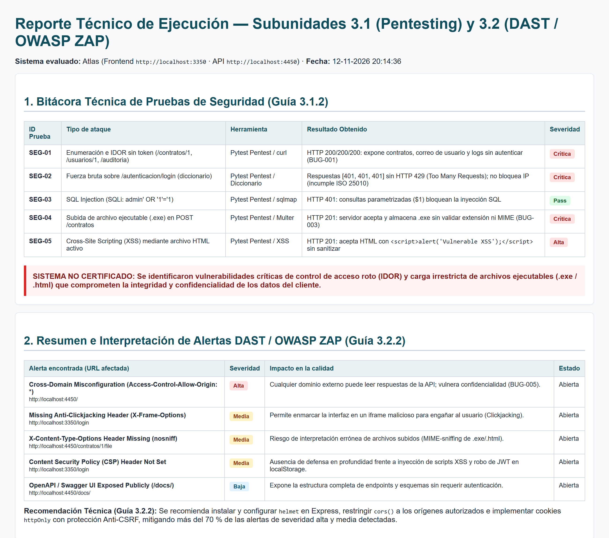

#### G.2. Reporte de Pruebas de Carga, Estrés y Pico (`test_atlas_stress.py` / `Atlas_Stress_Test_JMeter.jmx` → `reporte_estres_atlas.html`)

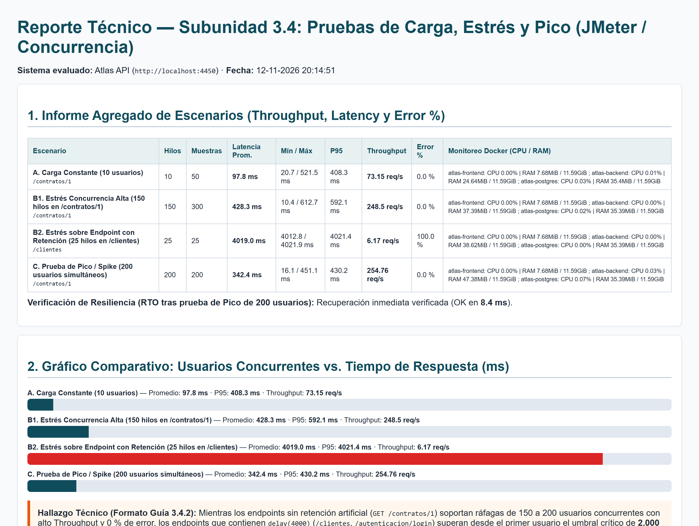

**Muestra de datos crudos registrados (`jmeter_resultados_atlas.csv` — total 575 muestras):**

```csv
ts,escenario,endpoint,code,latency_ms,ok,bytes
1794525277514,A. Carga Constante (10 usuarios),/contratos/1,200,394.47,True,239
1794525277512,A. Carga Constante (10 usuarios),/contratos/1,200,408.26,True,239
1794525277743,A. Carga Constante (10 usuarios),/contratos/1,200,188.99,True,239
1794525277884,A. Carga Constante (10 usuarios),/contratos/1,200,63.74,True,239
1794525277885,A. Carga Constante (10 usuarios),/contratos/1,200,78.54,True,239
1794525277515,A. Carga Constante (10 usuarios),/contratos/1,200,459.87,True,239
1794525277948,A. Carga Constante (10 usuarios),/contratos/1,200,28.92,True,239
1794525277964,A. Carga Constante (10 usuarios),/contratos/1,200,27.04,True,239
1794525277975,A. Carga Constante (10 usuarios),/contratos/1,200,20.74,True,239
1794525277886,A. Carga Constante (10 usuarios),/contratos/1,200,113.8,True,239
```

#### G.3. Extracto del Pipeline CI/CD DevSecOps (`ci-devsecops-atlas.yml`)

```yaml
name: CI-CD DevSecOps Atlas

on:
  push:
    branches: [ main, develop ]
  pull_request:
    branches: [ main ]

jobs:
  # ETAPA 1: CONTROL DE VERSIONES Y VALIDACIÓN DE SECRETS (FAIL FAST)
  secrets_and_sast:
    name: "1. Shift-Left: Secrets + SAST + SCA"
    runs-on: ubuntu-latest
    steps:
      - name: "1.1 Checkout del código fuente (Source)"
        uses: actions/checkout@v4
        with:
          fetch-depth: 0

      - name: "1.2 Validación de Secrets en repositorio (Gitleaks)"
        uses: gitleaks/gitleaks-action@v2
        env:
          GITHUB_TOKEN: ${{ secrets.GITHUB_TOKEN }}

      - name: "1.3 Configurar entorno Node.js 20 con caché"
        uses: actions/setup-node@v4
        with:
          node-version: "20"

      - name: "1.4 Gestión de Dependencias (SCA - npm audit Backend y Frontend)"
        run: |
          cd BACKEND && npm ci && npm audit --audit-level=high
          cd ../FRONTEND && npm ci && npm audit --audit-level=high

      - name: "1.5 SAST: Análisis Estático de Calidad y Seguridad (ESLint 9)"
        run: |
          cd BACKEND && npx eslint .
          cd ../FRONTEND && npx eslint .

      - name: "1.6 SAST: Escaneo SonarQube y Quality Gate"
        uses: SonarSource/sonarqube-scan-action@v3
        env:
          SONAR_TOKEN: ${{ secrets.SONAR_TOKEN }}
          SONAR_HOST_URL: ${{ secrets.SONAR_HOST_URL }}

  # ETAPA 2 Y 3: CONSTRUCCIÓN (BUILD) Y TESTING AUTOMATIZADO (PIRÁMIDE DE TESTING)
  build_and_test:
    name: "2. Build + Pruebas Unitarias, Integración y E2E"
    needs: secrets_and_sast
    runs-on: ubuntu-latest
    steps:
```

#### G.4. Evidencia de Ejecución y Extracto de Automatización Funcional E2E con Patrón Page Object Model (`test_atlas_pom.py`)

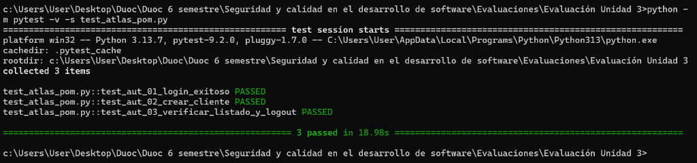

**Salida de consola registrada (`python -m pytest -v -s test_atlas_pom.py`):**

```text
platform win32 -- Python 3.13.7, pytest-9.2.0, pluggy-1.7.0
collected 3 items

test_atlas_pom.py::test_aut_01_login_exitoso PASSED
test_atlas_pom.py::test_aut_02_crear_cliente PASSED
test_atlas_pom.py::test_aut_03_verificar_listado_y_logout PASSED

======================== 3 passed in 18.98s ========================
```


```python
class LoginPage:
    """Page Object para la pantalla de Inicio de Sesión (/login)."""

    INPUT_USUARIO = (By.ID, "nombre_usuario")
    INPUT_PASSWORD = (By.ID, "password")
    BTN_LOGIN = (By.CSS_SELECTOR, '[data-testid="button-login"]')
    TITULO_LOGIN = (By.CSS_SELECTOR, "h2")

    def __init__(self, driver: webdriver.Remote, timeout: int = 12):
        self.driver = driver
        self.wait = WebDriverWait(driver, timeout)

    def abrir(self):
        self.driver.get(f"{BASE_URL}/login")
        return self

    def obtener_titulo(self) -> str:
        return self.wait.until(EC.visibility_of_element_located(self.TITULO_LOGIN)).text

    def iniciar_sesion(self, usuario: str, password: str):
        campo_usr = self.wait.until(EC.visibility_of_element_located(self.INPUT_USUARIO))
        campo_usr.clear()
        campo_usr.send_keys(usuario)

        campo_pwd = self.driver.find_element(*self.INPUT_PASSWORD)
        campo_pwd.clear()
        campo_pwd.send_keys(password)

        self.driver.find_element(*self.BTN_LOGIN).click()


class ClientesPage:
    """Page Object para el módulo de Gestión de Clientes (/clientes)."""

    NAV_CLIENTES = (By.CSS_SELECTOR, '[data-testid="link-nav-clientes"]')
    TITULO_MODULO = (By.CSS_SELECTOR, "h5")
    TAB_CREAR = (By.XPATH, "//button[contains(.,'Crear Cliente')]")
    INPUT_RUT = (By.ID, "rut-cliente-create")
    INPUT_NOMBRE = (By.ID, "nombre-cliente-create")
    INPUT_CORREO = (By.ID, "correo-cliente-create")
    INPUT_TELEFONO = (By.ID, "telefono-cliente-create")
    BTN_GUARDAR = (By.ID, "crear-cliente-create")
    ENCABEZADO_TABLA = (By.XPATH, "//h6[contains(.,'Clientes registrados')]")
    BTN_LOGOUT = (By.CSS_SELECTOR, '[data-testid="button-layout-logout"]')

    def __init__(self, driver: webdriver.Remote, timeout: int = 12):
```
